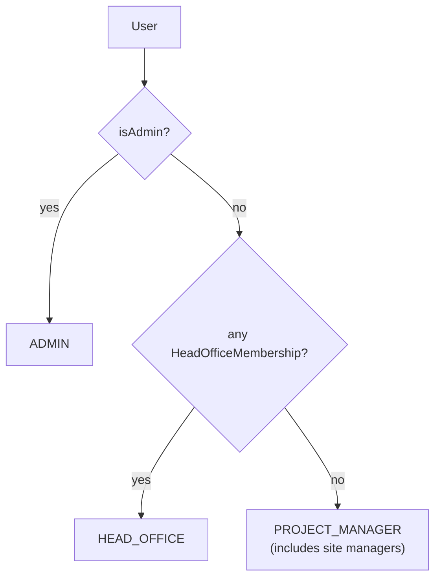
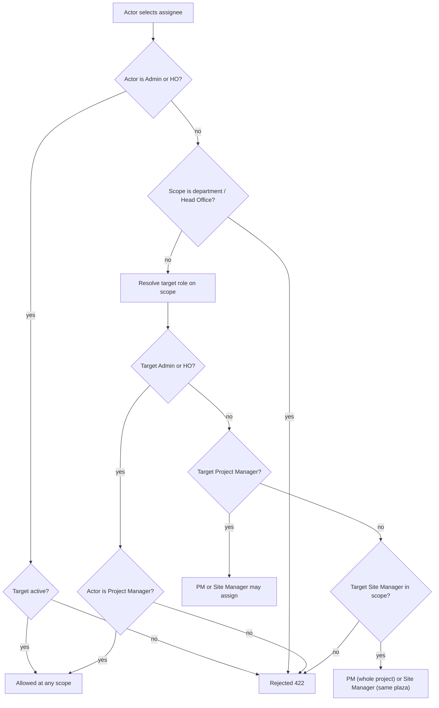
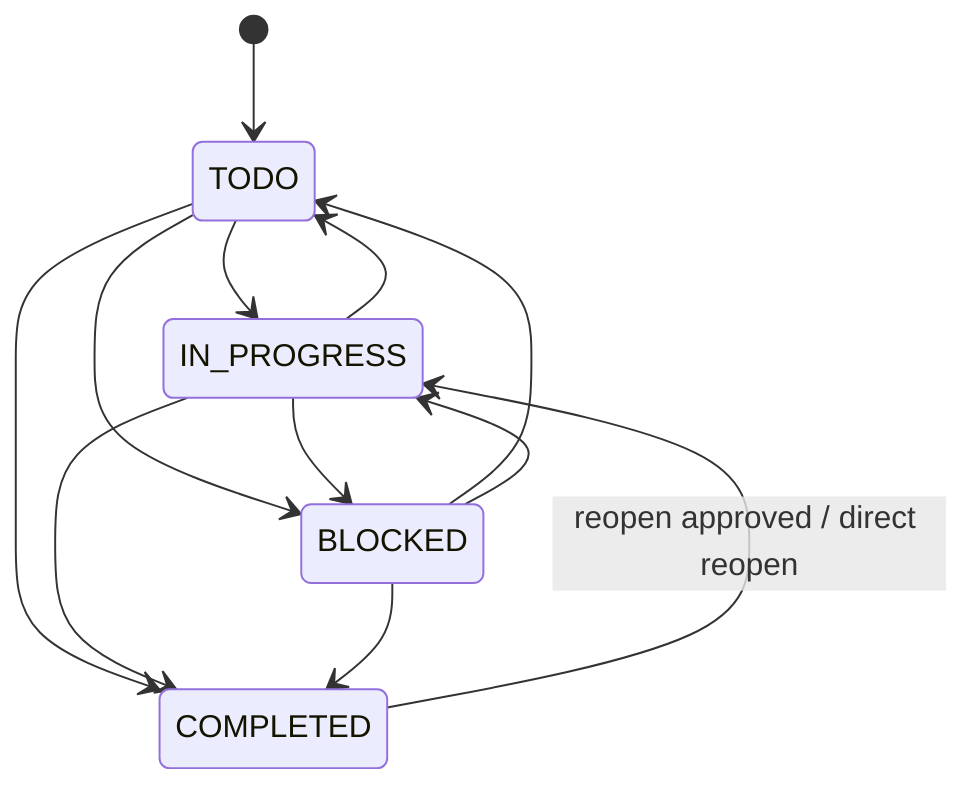

# Access Control — Project Site Tracker

Who can see and do what, and why. Everything here is derived from the code:
`lib/access.ts`, `lib/task-data.ts`, `middleware.ts` and the route handlers.

* Endpoint contracts: [`API.md`](./API.md)
* Request flows: [`SEQUENCES.md`](./SEQUENCES.md)
* Tables behind the assignments: [`ERD.md`](./ERD.md)

---

## 1. Identity model

There is **no account-level role column**. `User.isAdmin` is the only account
flag. Every other capability comes from assignment rows:

| Row | Grants |
|---|---|
| `User.isAdmin = true` | Admin |
| `HeadOfficeMembership` | Head Office (global) |
| `ProjectAssignment` | Project Manager on that project |
| `PlazaAssignment` (`TOLL` / `MAINTENANCE` / `CORRIDOR`) | Site Manager on that plaza |

A person may hold several rows at once. The **display role** is the highest one:

`PROJECT_MANAGER` is a display bucket, not a statement that the person manages a
project. The header badge refines it: if the person has at least one
`ProjectAssignment` it shows "Project Manager"; otherwise it shows their plaza
job titles ("Toll Manager · Corridor Manager"), falling back to "Project
Manager" when they hold none (`lib/badge.ts`).

### 1.1 JWT versus database re-read

The JWT stores only `id` and `isAdmin`, and the edge middleware uses it solely to
decide whether a session exists. Every server-side decision calls
`getSessionUser()`, which re-reads `active`, `isAdmin`, office and Head Office
memberships from PostgreSQL.

Consequences:

* Granting or revoking an assignment takes effect on the next request, with no
  re-login.
* Setting `User.active = false` makes every subsequent request `401`, even
  though the JWT is still cryptographically valid.
* The `isAdmin` value in the JWT is never the authorisation source; the DB row
  is.

### 1.2 Inactive users

* Cannot sign in (`authorize` returns `null` when `active` is false).
* Cannot use an existing session (`getSessionUser` returns `null`).
* Are excluded from the assignee picker and rejected by `canAssignTo`.
* Keep their historical rows: tasks they created, activities they performed and
  assignments they held are not rewritten.

---

## 2. Visibility

### 2.1 Projects

`accessibleProjectIds(user)`:

| Role | Projects visible |
|---|---|
| Admin | All |
| Head Office | All |
| Project Manager | Projects with a `ProjectAssignment` for the user, **plus** projects containing a plaza where the user has a `PlazaAssignment` |
| Site Manager | Same union: assigned plazas' projects and any project they manage |

A site manager therefore sees the *project* shell for every plaza they work on,
but not sibling plazas or their tasks.

### 2.2 Plazas

`accessiblePlazaIds(user)`:

| Role | Plazas visible |
|---|---|
| Admin / Head Office | All |
| Project Manager | Every plaza in every project they manage, plus direct plaza assignments |
| Site Manager | Only plazas with a direct `PlazaAssignment` |

### 2.3 Tasks

`taskScopeWhere(user)` builds the `WHERE` clause used by list, dashboard, stats
and the event feed:

| Role | Task visibility |
|---|---|
| Admin / Head Office | Everything |
| Project Manager | Every task whose `projectId` is in their project assignments (project-level **and** all plaza tasks), plus tasks assigned to them |
| Site Manager | Tasks on their assigned plazas, plus any task assigned to them (including project-level and Head Office tasks) |

The clauses are unioned, so holding both kinds of assignment widens visibility.

**Head Office tasks are invisible to project users unless assigned.** A task with
`departmentId != null` or `projectId == null` does not match any project or plaza
clause. The `assigneeId = user.id` clause is the only way a project or site user
sees it. `effectiveTaskRole` encodes the same rule: on a Head Office task, a
non-Admin/non-HO user gets `SITE_MANAGER` only when they are the assignee,
otherwise `null`.

### 2.4 Assignee override

Being assigned a task always grants read access and the status/comment rights
that come with `SITE_MANAGER`, even when the person holds no assignment on the
task's project or plaza. This is deliberate: work assigned to a person must be
actionable.

### 2.5 Master data

| Resource | Visibility |
|---|---|
| Companies | Admin/HO see all; others see companies with at least one accessible project |
| Projects | `accessibleProjectIds` |
| Plazas | `accessiblePlazaIds` |
| Departments | Admin/HO only (`GET /api/departments`) |
| Users directory | Admin/HO only (`GET /api/users`) |
| Categories | Any session (active rows; Admin also sees archived) |
| Dashboard | Any session, but every number is scoped to visible work |
| Events feed | Admin/HO only |
| Audit log | Admin/HO only |

Archived rows (`active = false`) remain visible in lists; `active` drives the
`ACTIVE`/`ARCHIVED` display status, not visibility.

---

## 3. Capability matrix

Legend: **Yes** = allowed; **No** = denied; **Scoped** = allowed only within the
person's assignment; **Ceiling** = allowed subject to the assignment ceiling in
§4.

| Capability | Admin | Head Office | Project Manager | Site Manager |
|---|---|---|---|---|
| Manage companies (create/update/archive) | Yes | No | No | No |
| Manage projects (create/update/archive) | Yes | Yes | No | No |
| Manage plazas (create/update/archive) | Yes | Yes | No | No |
| Manage categories | Yes | No | No | No |
| Manage users (create/update/deactivate/reset password) | Yes | No | No | No |
| List the user directory | Yes | Yes | No | No |
| Grant/revoke Head Office memberships | Yes | Yes | No | No |
| Grant/revoke project assignments | Yes | Yes | No | No |
| Replace plaza access | Yes | Yes | No | No |
| View departments and their stats | Yes | Yes | No | No |
| View the master-data audit log | Yes | Yes | No | No |
| View the task activity feed | Yes | Yes | No | No |
| View dashboard | Yes (global) | Yes (global) | Yes (scoped) | Yes (scoped) |
| Create a `PROJECT` task | Yes | Yes | Yes, on managed projects | No |
| Create a `PLAZA` task | Yes | Yes | Yes, any plaza in a managed project | Yes, own plazas only |
| Create a `DEPARTMENT` task | Yes | Yes | No | No |
| Create a `HEAD_OFFICE` task | Yes | Yes | No | No |
| Batch-create across scopes | Yes | Yes | Yes, only scopes they can create in | Yes, only own plazas |
| Edit task fields (title, description, priority, category, due date) | Yes | Yes | Yes, in scope | Only tasks they created |
| Change task status | Yes | Yes | Yes | Yes |
| Assign a project/plaza task | Yes | Yes | Yes | Yes (ceiling) |
| Assign a department/Head Office task | Yes | Yes | No | No |
| Comment | Yes | Yes | Yes | Yes |
| Upload/download attachments | Yes | Yes | Yes | Yes |
| Delete an attachment | Any | Own uploads | Own uploads | Own uploads |
| Request a reopen | n/a (direct) | n/a (direct) | Yes, on completed tasks | Yes, on completed tasks |
| Approve/reject a reopen request | Yes | Yes | No | No |
| Reopen directly | Yes | Yes | No | No |
| Cancel own pending reopen request | Yes | Yes | Yes | Yes |
| Cancel someone else's pending reopen request | Yes | No | No | No |
| Delete a task | No | No | No | No |

Notes:

* "Manage" always means the route exists and is guarded by
  `canManageProjects` or `isAdmin`; there is no delete for any master-data row,
  only archive.
* `canAdminDelete` in the task permission payload is **not** task deletion. It
  covers the two reversible deletes the UI offers: removing an attachment and
  cancelling another person's pending reopen request.
* Comments and uploads remain allowed on completed tasks; edits, assignment and
  status changes do not.

---

## 4. Assignment ceiling

`canAssignTo(actorRole, scope, targetUserId)` decides whether the selected
assignee is acceptable. It runs on create (when `assigneeId` is supplied) and on
every reassignment.

Read as rules:

| Actor | May assign |
|---|---|
| Admin / Head Office | Any **active** user, at any scope |
| Project Manager | Admin, Head Office, project managers on the project, site managers in the project |
| Site Manager | The project manager of the project, site managers on the same plaza |
| Project Manager / Site Manager | Never at department or Head Office scope |
| Anyone | Never an inactive user |

`targetRoleOnScope` resolves the target in this order: active check → Admin →
any Head Office membership (global, no company check) → project assignment →
plaza assignment. For a project-level task, "site manager in the project" means
a plaza assignment on **any** plaza of that project.

### 4.1 Assignee picker filtering

`assigneeCandidates(actorRole, scope, viewerId)` builds the picker payload:

1. **Association filter** — a candidate must hold:
   * a Head Office membership in the scope's department (or any membership when
     the scope is Head Office level), or
   * a project assignment on the scope's project, or
   * a plaza assignment on the scope's plaza (or any plaza of the project at
     project level).
2. **Active only** — inactive users are excluded.
3. **Viewer always included** — so "Assign to me" works even when the viewer is
   not associated with the scope. This is the single exception.
4. **Site-manager exclusions** — when the actor is a Site Manager, Admin accounts
   and anyone with a Head Office membership are removed, viewer included,
   because the ceiling forbids assigning them.
5. **Department scope** — a non-privileged actor gets an empty list.
6. **Labels and tiers** — each row gets `role`, `roleLabel`, `contextLabel`,
   `tier` (`this-scope`, `head-office`, `project-manager`, `site-manager`,
   `admin`) and a search haystack. `components/management/assignee-picker.tsx`
   groups by tier.

Candidate role precedence is Admin → Head Office → Project Manager → Site
Manager. A person who is both a project manager and a plaza manager is labelled
"Project Manager".

---

## 5. Task lifecycle permissions

### 5.1 Completed lock

When `status = COMPLETED`:

| Action | Result |
|---|---|
| `PATCH /api/tasks/:id` | `423` |
| `POST /api/tasks/:id/assign` | `423` |
| `POST /api/tasks/:id/status` | `422` |
| `POST /api/tasks/:id/comments` | Allowed |
| Attachment upload/download | Allowed |
| Request reopen | Allowed for PM/Site Manager |
| Direct reopen / approve | Allowed for Admin/HO |

The permission payload reflects this: `canEdit`, `canChangeStatus` and
`canAssign` are all `false`; `canComment` and `canUpload` stay `true`.

### 5.2 Reopen roles

| Role | Direct reopen | Request reopen | Approve/reject | Cancel own | Cancel other |
|---|---|---|---|---|---|
| Admin | Yes | n/a | Yes | Yes | Yes |
| Head Office | Yes | n/a | Yes | Yes | No |
| Project Manager | No | Yes | No | Yes | No |
| Site Manager | No | Yes | No | Yes | No |

A direct reopen moves the task to `IN_PROGRESS` and clears `completedAt` /
`completedById`. An approved request does the same; a rejected request leaves the
task completed. Cancelling marks the request `CANCELLED` and leaves the task
untouched.

Only one `PENDING` request per task is possible: the partial unique index
`TaskReopenRequest_taskId_pending_key` enforces it, and the route checks first to
return `409`.

### 5.3 Field edits

`canEditTaskCore`:

* `false` when completed;
* `true` for Admin, Head Office and Project Manager;
* for a Site Manager, `true` only when they created the task.

Note that a Site Manager assigned a **project-level** task can still reassign it
(`taskPermissions.canAssign` is true for any project-scoped task that is not
completed), subject to the ceiling. They cannot edit its fields unless they
created it.

---

## 6. Edge cases

### Multiple assignments

A person can be Admin and Head Office, or Head Office and a project manager, or a
project manager and a site manager. The highest applicable role wins at each
decision point:

* Display: Admin > Head Office > Project Manager.
* Task: Admin > Head Office > Project Manager (project assignment) > Site
  Manager (plaza assignment or assignee override).
* Visibility: clauses are unioned, so more assignments never reduce access.

A Head Office member with a project assignment is treated as Head Office
everywhere: `getSessionUser` returns `HEAD_OFFICE`, `taskScopeWhere` returns
`{}`, and `effectiveTaskRole` returns `HEAD_OFFICE`. The project assignment adds
no further reach because HO already sees everything.

### Department-scoped tasks

* Created only by Admin/HO.
* Invisible to project/site users unless assigned.
* An assigned project/site user acts as `SITE_MANAGER` on that task: status,
  comment and upload are allowed; core edits only if they created it; assignment
  is denied because `canAssign` requires Admin/HO for non-project scopes.
* Department membership is **not** a permission boundary. Any HO member can see
  every department's tasks; the membership only supplies the display department
  and the assignee-picker association.

### Project-level tasks assigned to a site manager

* Visible through the `assigneeId` clause even without a plaza assignment on
  that task.
* `effectiveTaskRole` returns `SITE_MANAGER`.
* Status, comments, uploads and (re)assignment are allowed; core edits only if
  they created it.

### Archived projects and plazas

`active` is presentation and archive state, not an access gate. An archived
project or plaza:

* still appears in scoped lists, labelled `ARCHIVED`;
* still grants access through its assignments;
* still accepts new tasks (creation checks assignment, not `active`).

If archiving should block new work, that is a product decision not yet
implemented.

### Users with no assignments

* Display role is `PROJECT_MANAGER`.
* They see only tasks explicitly assigned to them (`assigneeId = user.id`).
* Their project and plaza lists are empty.
* They cannot create tasks at any scope.
* They can still read and act on tasks assigned to them.

### Admin and Head Office reach

Both are global: all companies, projects, plazas, tasks, departments, users and
audit rows. There is no per-company or per-department restriction for either.

### Attachments

Any user with task access can upload and download. Deletion is limited to the
uploader or an Admin. The check happens after `requireTaskAccess`, so a user
cannot delete an attachment on a task they cannot see.

---

## 7. Why this design

**Assignment-derived roles.** A single `User.role` column cannot express "runs
two projects in one company, covers a plaza in another, and sits in Finance at
Head Office". Assignment rows model reality directly, and removing a row removes
the capability without touching the account.

**Head Office is global.** The organisation is a matrix: functional departments
work across all three companies. A company-scoped HO grant would force duplicate
rows and would still not match how the work is assigned. Department membership
therefore supplies identity and a task location, not a visibility boundary.

**Explicit task scope.** Storing `Task.scope` (backed by a CHECK) makes the
location unambiguous for filtering, authorisation and the UI. The alternative —
inferring scope from which nullable columns happen to be set — made it easy to
create rows that meant different things to different queries.

**Assignee override.** Work assigned to a person must be actionable even if the
reporting lines are incomplete. The override is deliberately narrow: read access,
status, comments and uploads, not core edits or reassignment of Head Office work.

**DB re-read on every request.** Authorisation that trusts a long-lived token
drifts from the database. Re-reading the user makes revocation immediate and
keeps the edge middleware cheap.

The trade-offs and alternatives are recorded in
[`DECISIONS.md`](./DECISIONS.md).
