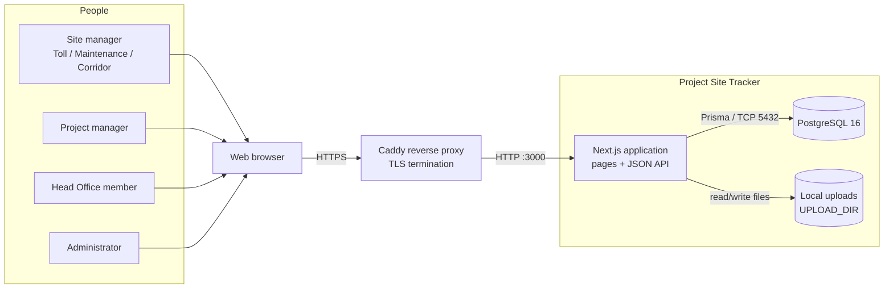
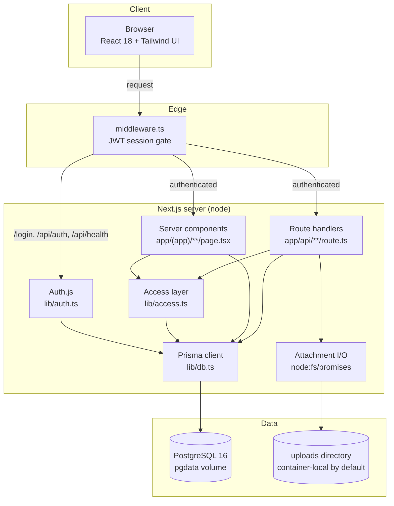
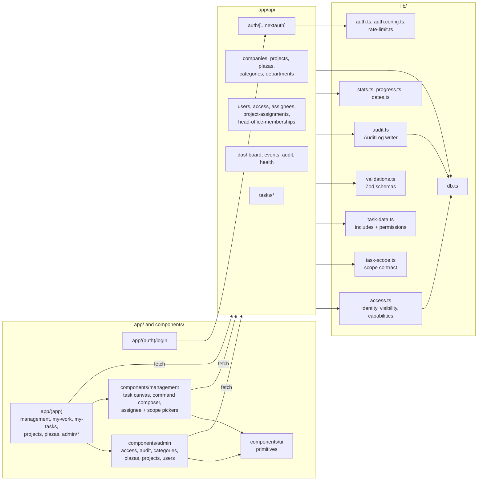
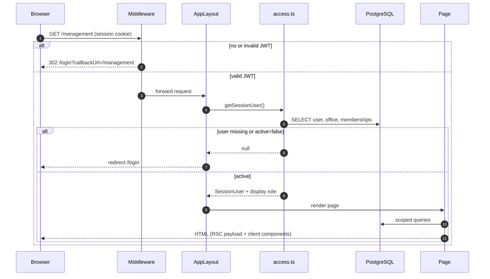
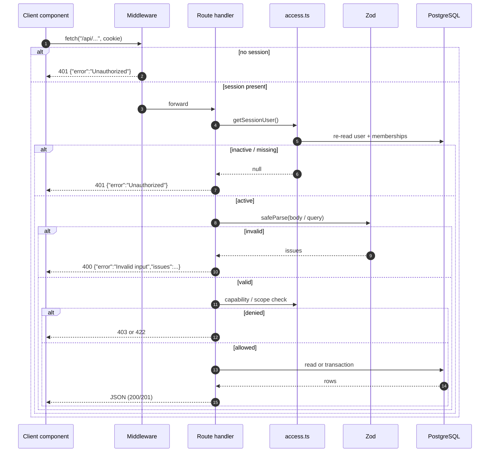
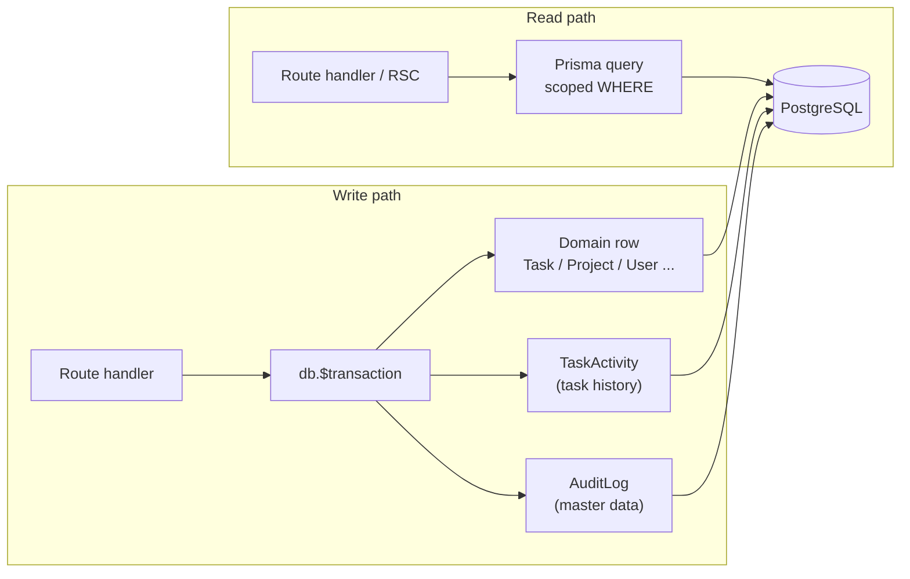
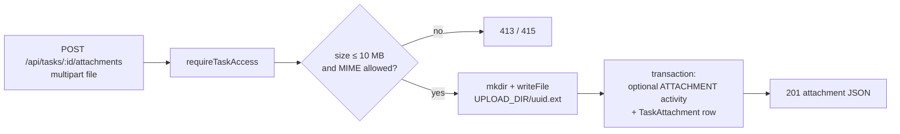
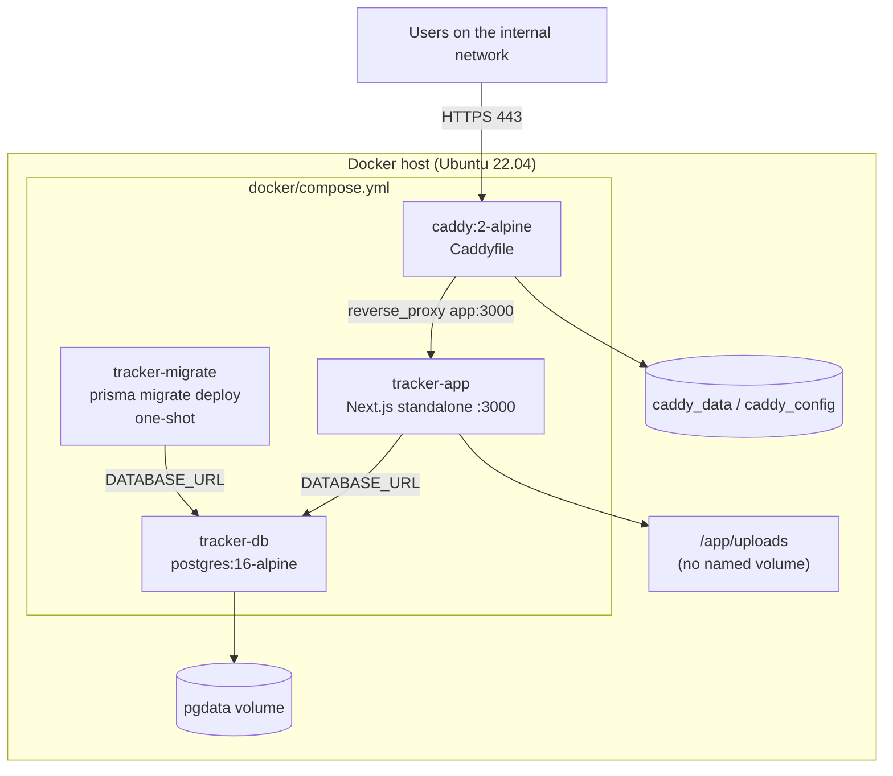

# Architecture — Project Site Tracker

How the pilot is put together: what runs where, how a request travels, where
authorisation is enforced, and which parts are deliberately simple.

* Data model: [`ERD.md`](./ERD.md) and [`SCHEMA.md`](./SCHEMA.md)
* Endpoints: [`API.md`](./API.md)
* Who may do what: [`ACCESS-CONTROL.md`](./ACCESS-CONTROL.md)
* Flows step by step: [`SEQUENCES.md`](./SEQUENCES.md)
* Deployment and operations: [`OPERATIONS.md`](./OPERATIONS.md), [`DEPLOY.md`](./DEPLOY.md)

---

## 1. Purpose and scope

Project Site Tracker tracks toll-plaza site work across three NHIT companies.
The domain hierarchy is **Company → Project → Plaza → Task → Activity**, with a
parallel **Head Office** axis (department-scoped and Head Office-level tasks).

This document covers the runtime architecture of the web application. It does
not restate the database design; it explains how the pieces fit together and
why the system is shaped the way it is.

**Audience:** engineers joining the project, reviewers checking the security
model, and operators who need to know what a request touches.

### Quick facts

| Question | Answer |
|---|---|
| Application | Next.js 14.2 App Router, React 18, TypeScript |
| Rendering | React Server Components for pages; client components for interactive workspaces |
| API style | Route handlers under `app/api/**` returning JSON |
| Database | PostgreSQL 16 via Prisma 6.19 (`prisma/schema.prisma`) |
| Authentication | Auth.js / NextAuth v5 beta, Credentials provider, JWT session |
| Password storage | `bcryptjs`, cost factor 12 |
| Authorisation | Derived from assignment rows; **no account role column** |
| Session gate | Edge middleware (`middleware.ts`) decoding the JWT cookie |
| Per-request identity | `lib/access.ts#getSessionUser` re-reads the user from the DB |
| File storage | Local filesystem (`UPLOAD_DIR`, default `<cwd>/uploads`) |
| Deployment | Docker Compose: Postgres, one-shot migrate job, Next.js standalone, Caddy |
| Background jobs | None |
| Cache / queue | None |
| External services | None (fonts fetched at image build time) |

---

## 2. System context

Who uses the system and what it depends on.

There is no email service, no SMS gateway, no object storage and no analytics
pipeline. The only runtime dependency is PostgreSQL; the only persistent state
outside it is the attachment directory.

---

## 3. Container view

**Boundaries that matter**

* The middleware only proves that a valid session cookie exists. It does not
  query the database and does not know the user's assignments.
* Every page and every route handler re-establishes identity through
  `getSessionUser()`. A deactivated user with a still-valid JWT is rejected at
  that point, not at the edge.
* Route handlers are the only writers. Server components read; client
  components call the JSON API.

---

## 4. Component map

### Responsibility table

| Area | Path | Responsibility |
|---|---|---|
| Root layout | `app/layout.tsx` | HTML shell, fonts, global CSS |
| Auth layout | `app/(auth)/login/page.tsx` | Credentials sign-in form |
| App layout | `app/(app)/layout.tsx` | Session guard, header badge, cockpit shell |
| Entry redirect | `app/page.tsx` | `/management` for Admin/HO, `/my-work` for everyone else |
| Management workspace | `app/(app)/management/page.tsx` | Admin/HO portfolio and task surface |
| My work / my tasks | `app/(app)/my-work`, `app/(app)/my-tasks` | Project-manager and site-manager views |
| Project / plaza detail | `app/(app)/projects/[id]`, `app/(app)/plazas/[id]` | Scoped drill-down |
| Admin console | `app/(app)/admin/**` | Users, access, categories, projects, plazas, audit |
| Route handlers | `app/api/**/route.ts` | JSON API, validation, authorisation, writes |
| Access layer | `lib/access.ts` | Session identity, visibility queries, capability rules, assignee picker |
| Scope contract | `lib/task-scope.ts` | `Task.scope` semantics shared by server and client |
| Task projections | `lib/task-data.ts` | Prisma includes, permission object, labels |
| Validation | `lib/validations.ts` | Zod schemas, id rules, attachment limits |
| Audit | `lib/audit.ts` | `AuditLog` writer and safe snapshots |
| Statistics | `lib/stats.ts`, `lib/progress.ts` | KPI/progress aggregation |
| Dates | `lib/dates.ts` | IST day boundaries and overdue logic |
| Auth | `lib/auth.ts`, `lib/auth.config.ts` | Credentials provider, JWT callbacks, edge-safe config |
| Rate limit | `lib/rate-limit.ts` | In-memory login throttle |
| DB client | `lib/db.ts` | Prisma singleton |
| Schema | `prisma/schema.prisma` | 15 models, 7 enums |
| Migrations | `prisma/migrations/*` | Forward-only DDL, CHECKs and partial unique indexes |
| Seed | `prisma/seed.ts`, `prisma/master-data.ts` | Demo catalogue and users |

**Dependency direction:** `app/` → `lib/` → Prisma. `lib/task-scope.ts` and
`lib/assignee-groups.ts` are deliberately dependency-free (Prisma *types* only)
so client components can import them without pulling the database into the
bundle.

---

## 5. Request lifecycle

### 5.1 Page request

The app layout calls `getSessionUser()` again even though middleware already
saw a session. That second read is what makes deactivation and role changes take
effect immediately.

### 5.2 API request

Access helpers throw a `Response` (`401`, `403`, `404`) which route handlers
catch and return unchanged. That is why handlers have the recurring
`if (e instanceof Response) return e;` pattern.

---

## 6. Authentication and session

| Step | Implementation |
|---|---|
| Sign-in form | `app/(auth)/login/page.tsx` → `signIn("credentials")` |
| Provider | `lib/auth.ts` — `Credentials` with `email` + `password` |
| Validation | `loginSchema` (email format, password ≥ 6) |
| Throttle | `rateLimit("login:<email>")` — 5 attempts / 60 s, in memory |
| User lookup | `db.user.findUnique({ where: { email } })`, email lower-cased |
| Password check | `bcrypt.compare` against `User.passwordHash` |
| Inactive users | `authorize` returns `null` when `active` is false |
| Session | JWT strategy; token carries `id` and `isAdmin` |
| Cookie | Auth.js session cookie, `HttpOnly`, `SameSite=Lax` by default |
| Edge gate | `middleware.ts` calls `auth()` with the edge-safe config |
| Server identity | `getSessionUser()` re-reads `active`, `isAdmin`, memberships, office |

`lib/auth.config.ts` is intentionally free of `db` and `bcryptjs` imports so the
middleware bundle can run on the edge runtime. The Node-only pieces live in
`lib/auth.ts`.

**Why the JWT is not trusted for authorisation:** `isAdmin` in the token is a
convenience for the edge gate only. Every server-side decision uses the fresh
database row. Removing an assignment or setting `active = false` takes effect on
the next request without forcing a re-login.

**Not implemented:** password reset by email, MFA, SSO, account lockout beyond
the in-memory throttle, session revocation list, CSRF tokens on JSON routes
(Auth.js protects its own callback endpoints; JSON routes rely on same-origin
cookies and the absence of CORS headers).

---

## 7. Authorisation in one paragraph

There is no `User.role` column. A person's display level is derived:

1. `User.isAdmin` → **Admin**
2. any `HeadOfficeMembership` → **Head Office**
3. otherwise → **Project Manager** (which includes site managers for display)

For a specific task, the effective role is the highest role the person holds in
that task's scope: Admin, Head Office, Project Manager (`ProjectAssignment`), or
Site Manager (`PlazaAssignment`). Head Office is global. Department membership is
display metadata and a task location, never a permission boundary. The full
matrix, assignment ceiling and edge cases are in
[`ACCESS-CONTROL.md`](./ACCESS-CONTROL.md).

---

## 8. Data and consistency

* **Prisma singleton** — `lib/db.ts` caches the client on `globalThis` outside
  production to survive hot reload.
* **Transactions** — task creation (including batch), field edits, status
  changes, assignment, comments, attachment metadata, reopen decisions and every
  master-data mutation that writes an audit row run in `db.$transaction`.
* **Two histories, on purpose**
  * `TaskActivity` is the task feed: creation, comments, assignment, status,
    reopen events, attachments, field edits.
  * `AuditLog` is the master-data trail: companies, projects, plazas, users,
    categories, memberships and assignments, with before/after JSON snapshots.
* **Append-only** — there is no update or delete endpoint for either history.
  The only deletes in the product are an attachment (uploader or Admin) and the
  cancellation of a pending reopen request (requester or Admin), both of which
  leave an activity row.
* **Stable ids** — generated rows use `cuid()`; catalogue rows use slug ids such
  as `company_neppl`, `dept_fin`, `office_delhi`, `cat_toll_operations`.
* **Soft archive** — master data is retired with `active = false`, never
  deleted while referenced. Users are deactivated, never deleted.
* **Scope integrity** — `Task.scope` is an explicit discriminator backed by the
  `Task_scope_kind_check` CHECK constraint. The API also resolves a plaza to its
  project before writing, so the two columns cannot disagree.

Known gaps are listed in [`ERD.md` § Open questions](./ERD.md#9-open-questions)
and repeated in §12 below.

---

## 9. Cross-cutting concerns

| Concern | Implementation | Notes |
|---|---|---|
| Input validation | Zod schemas in `lib/validations.ts` | `safeParse` at every write; `400` with `issues` |
| Id validation | `idSchema` = non-empty string, ≤ 64 chars | Never assumes cuid shape |
| Dates | `lib/dates.ts`, `Asia/Kolkata` | `Task.dueDate` is `date`; "today" is IST midnight represented as UTC midnight |
| Overdue | `dueDate < todayIst()` and status ≠ `COMPLETED` | Used by list filters and stats |
| Progress | `plazaProgress(completed, total)` | Rounded percentage; `BLOCKED` is not a progress value |
| Errors | `{ "error": string }`, optional `issues` | Thrown `Response`s are re-returned as-is |
| Status codes | 200, 201, 400, 401, 403, 404, 409, 413, 415, 422, 423 | See [`API.md`](./API.md) |
| Uploads | Multipart, 10 MB, JPG/PNG/WebP/PDF | Stored as `<uuid>.<ext>`; DB stores `storedName` |
| Download | `GET /api/attachments/:id` after task access check | `Content-Disposition: inline` |
| Rate limiting | In-memory map, 5 login attempts/min/email | Per process; resets on restart |
| Logging | Framework/container stdout only | No structured logger, no tracing, no metrics |
| Health | `GET /api/health` returns `{ ok, time }` | Does **not** ping the database |
| CSRF | Same-origin cookies; no explicit token on JSON routes | Auth.js handles its own endpoints |
| CORS | Not configured | Browser clients are same-origin |

### Upload path

The file is written before the database row. If the transaction fails, the
orphaned file is not cleaned up automatically. There is no virus scan, image
resize or content sniffing; the MIME type is taken from the multipart part.

---

## 10. Deployment topology

Startup order is enforced by Compose: `db` healthy → `migrate` completes
successfully → `app` starts → `caddy` proxies. The `migrate` service uses the
`tools` build stage (full dependencies, Prisma CLI); the runtime `app` stage is a
lean standalone bundle with no Prisma CLI and no `tsx`.

**Uploads are the weak point of this topology.** `docker/compose.yml` mounts no
volume for `UPLOAD_DIR`, so attachments live inside the `tracker-app` container
and are lost when the container is recreated (`up --build`, a crash-loop
recreate, or a host move). See [`OPERATIONS.md`](./OPERATIONS.md#backup-and-restore).

Environment variables and the full runbook are in
[`OPERATIONS.md`](./OPERATIONS.md) and [`DEPLOY.md`](./DEPLOY.md).

---

## 11. Tech stack

| Layer | Choice | Version | Why it is here |
|---|---|---|---|
| Framework | Next.js (App Router) | 14.2.35 | Server components, route handlers, standalone output |
| UI runtime | React | 18 | Required by Next.js 14 |
| Language | TypeScript | 5.x | Type safety across Prisma and Zod |
| Styling | Tailwind CSS + `tailwindcss-animate` | 3.x | Utility styling |
| Primitives | Radix Slot, `class-variance-authority`, `clsx`, `tailwind-merge` | — | shadcn/ui-style component layer |
| Icons | `lucide-react` | 0.453 | Icon set |
| Tables | `@tanstack/react-table` | 8.20 | Admin grids |
| Forms | `react-hook-form` + `@hookform/resolvers` | 7.x / 3.x | Client forms |
| Validation | Zod | 3.23 | Shared request validation |
| ORM | Prisma Client | 6.19.3 | Typed queries, transactions, migrations |
| Database | PostgreSQL | 16-alpine | Relational model, partial indexes, CHECKs |
| Auth | NextAuth / Auth.js | 5.0 beta 32 | Credentials + JWT |
| Hashing | `bcryptjs` | 3.0 | Password hashing (cost 12) |
| Proxy | Caddy | 2-alpine | TLS termination and reverse proxy |
| Runtime | Node.js | 20-alpine | Container base image |

No state-management library, no data-fetching library, no chart library and no
component framework beyond the small local UI primitives.

---

## 12. Non-functional characteristics and known limitations

### What the design optimises for

* **Auditability** — every task mutation and every master-data change leaves a
  row; nothing is hard-deleted except an attachment.
* **Simple operations** — one database, one app container, one proxy, no queue
  or cache to run.
* **Immediate permission changes** — assignments are read per request, so
  granting or revoking access does not require a re-login.
* **Explicit scope** — a task's location is a stored discriminator, not an
  inference from nullable columns.

### Known limitations and risks

| Area | Limitation | Consequence |
|---|---|---|
| Uploads | Container-local directory, no volume in `compose.yml` | Attachments disappear on container recreation; not covered by `pg_dump` |
| Rate limiting | In-memory, per process | Resets on restart; ineffective across replicas |
| Health check | `/api/health` does not query the DB | A running app with a broken DB still reports `ok` |
| Observability | No structured logs, metrics or tracing | Incidents are debugged from container stdout |
| Task scope | No DB constraint that `Task.plaza.projectId = Task.projectId` | API resolves it, raw SQL could violate it |
| Activity shape | No per-type CHECK on `TaskActivity` | A row can carry fields its type does not use |
| Assigner ids | `assignedById` on assignment tables has no FK | A deleted/renamed id would not be caught by the DB |
| Audit vocabulary | `AuditLog.entity` and `action` are unconstrained text | Typos are possible; only writers enforce the vocabulary |
| Unique indexes | Ignore `active` | Archiving keeps the name/code reserved |
| Pagination | Only `/api/tasks` paginates | Project/plaza/user lists return everything |
| Search | `q` matches task title only | No full-text search across descriptions/comments |
| Sessions | JWT with no revocation list | A stolen cookie is valid until expiry unless the user is deactivated |
| Scaling | Single app instance assumed | In-memory limiter and local uploads break with replicas |
| Migrations | Forward-only, no down migrations | Recovery is restore-from-backup or a new forward migration |

### Extension points

* Add a named volume for `UPLOAD_DIR` (or move to object storage) before any
  multi-instance deployment.
* Replace `lib/rate-limit.ts` with a shared store (Redis/Postgres) if the app is
  replicated.
* Add a DB CHECK or trigger for `Task.plaza.projectId = Task.projectId` if raw
  SQL writes become possible.
* Add pagination to the master-data list endpoints if the catalogue grows.
* Add a readiness endpoint that runs `SELECT 1` alongside the existing liveness
  endpoint.
* Introduce a structured logger and request ids if the pilot moves to
  production-grade operations.

---

## 13. Related documents

| Document | Use it for |
|---|---|
| [`ERD.md`](./ERD.md) | Entity relationships, cardinality, constraints |
| [`SCHEMA.md`](./SCHEMA.md) | Column dictionary, enums, indexes, migration history |
| [`DATABASE.md`](./DATABASE.md) | Intended data design and role model |
| [`API.md`](./API.md) | Endpoint contracts |
| [`ACCESS-CONTROL.md`](./ACCESS-CONTROL.md) | Capability matrix and edge cases |
| [`SEQUENCES.md`](./SEQUENCES.md) | Login, task lifecycle, reopen, upload, audit flows |
| [`OPERATIONS.md`](./OPERATIONS.md) | Environments, env vars, migrations, incidents |
| [`DECISIONS.md`](./DECISIONS.md) | Why the architecture looks like this |
| [`GLOSSARY.md`](./GLOSSARY.md) | Terms and acronyms |
