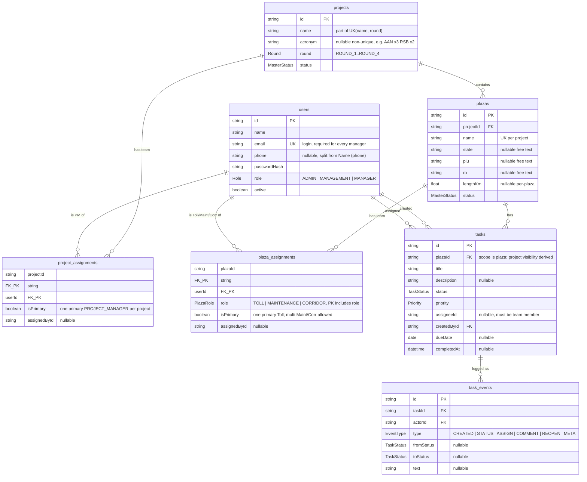

# Database Design — Project Site Tracker (v2, fresh)

Source of truth: `prisma/schema.prisma` (PostgreSQL 16).
Flow: `Project -> Plaza -> Project Manager -> Other Managers (Toll / Maintenance / Corridor)`.
Location fields (`state/piu/ro`) are free text on `plazas` (per decision: no master tables for v1).

## Why not group by acronym

From `docs/NHIT Project List.md`:

* 1 project with 2 acronyms (`Palanpur`: AP/AS) — group-by-acronym would wrongly split it.
* 1 acronym shared by different projects (`RSB` x2, `AAN` x3) — group-by-acronym would wrongly merge them.
* Continuation rows carry blank acronyms (`CK`, `RKJL`, `MH`, `Amravati` follow-ons).

So `projects.acronym` is display/search only: nullable, non-unique, indexed.
Canonical identity is `@@unique([name, round])` after cleaning:
`AS/Undvariya` folds into Palanpur, three `Amravati - Chikhali` rows merge into one
(see `scripts/parse-nhit.py` overrides). Result: 28 projects, 46 plazas.

## Diagram

## Relationship rules

| Rule | Enforced by |
|---|---|
| Job title lives on the assignment, access level on `users.role` | `Role` = ADMIN/MANAGEMENT/MANAGER; same user can be PM on one project + Maintenance on another (sheet does this: Rohit Kumar, Sreedhar, Mintu Nandi) |
| One primary PM per project; one primary Toll per plaza; multiple Maintenance/Corridor allowed | `isPrimary` flag, app-level check (one `isPrimary=true` per project / per plaza+role) |
| Vacant post = no row (`NA`/blank in Excel imports as nothing) | seed skips `NA`/blank via `scripts/parse-nhit.py:clean_name` |
| `plaza_assignments` is access control — no separate access table | `lib/access.ts:accessiblePlazaIds`, `requirePlazaAccess` |
| PM of a project sees all its plazas | access helper expands `project_assignments` to child plaza ids |
| Deleting a project/plaza with children is blocked | `onDelete: Restrict` on Project→Plaza, Plaza→Task, Task→TaskEvent |
| Assignment rows vanish with their user/plaza/project | `onDelete: Cascade` on both assignment tables only |
| Deactivating a user keeps history | no user DELETE path; `active=false`, tasks keep `assigneeId` |
| Tasks and events are never deleted | no DELETE routes; `task_events` append-only |
| Completed tasks lock edits | app-level 423 (reopen via ADMIN/MANAGEMENT only) |
| Only ADMIN deletes/deactivates | `canDelete` / `isAdmin` gates; MANAGEMENT can create/edit/assign but never delete |

## Permissions

| Action | ADMIN | MANAGEMENT | MANAGER |
|---|---|---|---|
| add users, deactivate users, delete projects/plazas | yes | no | no |
| add/edit Projects, Plazas | yes | yes | no |
| assign/revoke PM, Toll/Maintenance/Corridor | yes | yes | no |
| create/edit tasks, comment, change status in assigned plazas | yes | yes | yes, assigned only |
| reopen completed tasks | yes | yes | no |
| view unassigned projects/plazas | yes | yes | no (assigned only) |

## Import rules (`scripts/parse-nhit.py` → `prisma/nhit-data.ts` → `prisma/seed.ts`)

* New project starts at a row with S.No; blank S.No rows continue it.
* Blanks inherit downward within the block (PM, state, PIU/RO).
* People: split ` `/newlines, strip phones + `(…)` annotations, drop `NA`/blank. Phones are discarded in v1 (`users.phone` left null, editable later).
* Length: numeric or `=a+b+…` formula evaluated and summed; blank → null.
* Seed logins: every manager gets a login (`slug@tracker.local`, default `Tracker@123`); role is `MANAGER` for all Excel names (PM vs Toll is the assignment, not the role). Plus `admin@tracker.local` (ADMIN) and seeded MANAGEMENT account(s).

## Data profile (fresh seed)

28 Projects → 46 Plazas → 40 sample Tasks (+ events); ~90 Users (1 ADMIN, 1 MANAGEMENT, rest MANAGER) linked via `project_assignments` / `plaza_assignments`. Seed: `prisma/seed.ts` (`SEED_RESET=1` wipe), source `prisma/nhit-data.ts` ← `scripts/parse-nhit.py` ← `docs/NHIT Project List.xlsx`.
