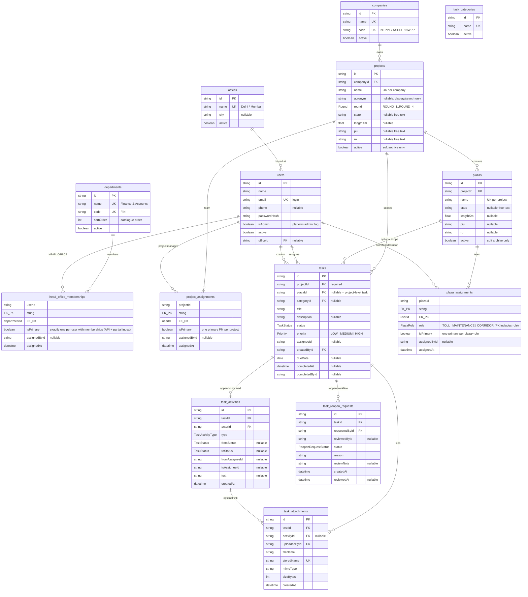

# Database Design — Project Site Tracker

Source of truth: `prisma/schema.prisma` (PostgreSQL 16).
Hierarchy: **Company → Project → Plaza**, with access granted by assignment:
`HeadOfficeMembership (HEAD_OFFICE)` / `ProjectAssignment (Project Manager)` /
`PlazaAssignment (TOLL | MAINTENANCE | CORRIDOR)`.

There is no account-level role column. `User.isAdmin` is the only account flag;
everything else is derived from the assignment rows a person holds. Head Office
is one **global** grant: a department membership is not scoped to a company.
Departments and offices are organisational metadata only — they never gate
visibility, task permissions or approvals. Projects and plazas have no lifecycle
status — only `active` (soft archive).

## Diagram



## Models

### People and companies

* **User** — login identity (`email` unique), display name, optional phone,
  bcrypt `passwordHash`, `isAdmin`, `active`, and a nullable `officeId` (the
  office the person sits in). Deactivating sets `active=false`; users are never
  deleted, so task history keeps its actor/assignee joins.
* **Company** — `name` and `code` are unique; `active` soft-archives.
* **Department** — global Head Office catalogue shared by every company:
  `name` and `code` are unique, `sortOrder` drives display order, `active`
  retires a department from new memberships. Departments are organisational
  metadata only — they do **not** gate visibility, task permissions, project
  management or reopen approval.
* **Office** — where a person sits (`Delhi`, `Mumbai`); `name` is unique,
  `city` is optional, `active` is a display flag.
* **HeadOfficeMembership** — `@@id([userId, departmentId])`; holding any row
  makes the person Head Office across **every** company — there is no
  per-company row. `isPrimary` marks the department shown in the header; a
  person with memberships always has **exactly one** primary row, maintained by
  the membership API and backed by the partial unique index below.
  `assignedById` records who granted the membership.
* **Project** — belongs to exactly one company (`onDelete: Restrict`).
  `@@unique([companyId, name])` makes the name canonical within a company.
  `acronym` is nullable, non-unique, indexed, and used for display/search only —
  the same acronym can appear on different projects, and continuation projects
  may have none. `active=false` means archived; projects are never completed
  and have no separate lifecycle status.
* **ProjectAssignment** — `@@id([projectId, userId])`; a project manager sees
  every plaza and task in that project. `isPrimary` marks the lead PM (one per
  project by convention; not a DB constraint).
* **Plaza** — belongs to one project; `@@unique([projectId, name])`. Location
  fields (`state`, `piu`, `ro`, `lengthKm`) are nullable free text/numeric on the
  plaza. `active=false` archives it.
* **PlazaAssignment** — `@@id([plazaId, userId, role])`; a person can hold
  several job titles on the same plaza and several plazas at once.
  `isPrimary` marks the lead for each `plazaId + role` by convention.

### Task domain

* **TaskCategory** — admin-managed lookup (`name` unique, `active`). Tasks keep
  `categoryId` nullable; deleting a category sets it to `null` (`SetNull`).
* **Task** — `projectId` is **required**; `plazaId` is nullable. A task with
  `plazaId = null` is a **project-level** task. `status` starts at `TODO`;
  `assigneeId` is optional; `dueDate` is a date; `completedAt` / `completedById`
  record completion. Deleting a project/plaza with tasks is blocked
  (`onDelete: Restrict`) — archive instead.
* **TaskActivity** — immutable, append-only history and comments in one stream.
  A comment is simply `type = COMMENT` with `text`. Rows record the actor,
  optional status transition (`fromStatus` → `toStatus`), optional assignee
  transition (`fromAssigneeId` → `toAssigneeId`), free text, and `createdAt`.
  There are no update/delete endpoints for activities; the audit page is
  read-only.
* **TaskAttachment** — file metadata (`fileName`, unique `storedName`,
  `mimeType`, `sizeBytes`) linked to its task and optionally to the activity
  that introduced it. Deleting a task cascades its attachments; deleting an
  activity sets `activityId` to `null` but keeps the file.
* **TaskReopenRequest** — one row per reopen request with `reason`, reviewer,
  `reviewNote`, and `status`. A **partial unique index** allows at most one
  pending request per task:

  ```sql
  CREATE UNIQUE INDEX "TaskReopenRequest_taskId_pending_key"
    ON "TaskReopenRequest"("taskId") WHERE "status" = 'PENDING';
  ```

## Enums

| Enum | Values |
|---|---|
| `PlazaRole` | `TOLL`, `MAINTENANCE`, `CORRIDOR` |
| `Round` | `ROUND_1`, `ROUND_2`, `ROUND_3`, `ROUND_4` |
| `TaskStatus` | `TODO`, `IN_PROGRESS`, `BLOCKED`, `COMPLETED` |
| `Priority` | `LOW`, `MEDIUM`, `HIGH` (three values only) |
| `TaskActivityType` | `CREATED`, `COMMENT`, `ASSIGNED`, `STATUS_CHANGED`, `REOPEN_REQUESTED`, `REOPEN_APPROVED`, `REOPEN_REJECTED`, `REOPEN_CANCELLED`, `REOPENED`, `ATTACHMENT`, `UPDATED` |
| `ReopenRequestStatus` | `PENDING`, `APPROVED`, `REJECTED`, `CANCELLED` |

## Integrity and deletion rules

| Rule | Enforced by |
|---|---|
| Company deletion is blocked while projects exist | `Project.company` → `onDelete: Restrict` |
| Project deletion is blocked while plazas or tasks exist | `Plaza.project`, `Task.project` → `Restrict` |
| Plaza deletion is blocked while tasks exist | `Task.plaza` → `Restrict` |
| Head Office memberships vanish with their user or department | `HeadOfficeMembership.user` / `.department` → `Cascade` |
| Project/plaza assignments vanish with their user/project/plaza | assignment relations → `Cascade` |
| Deleting an office keeps its people and clears their office | `User.office` → `SetNull` |
| Exactly one primary department per person with memberships | `POST`/`PUT`/`DELETE` + partial unique index `HeadOfficeMembership_userId_primary_key` |
| Task history/attachments/reopen rows vanish only with the task | `Task` children → `Cascade` |
| Deleting a category keeps tasks | `Task.category` → `SetNull` |
| One pending reopen request per task | partial unique index shown above |
| Project names unique per company; plaza names unique per project | `@@unique([companyId, name])`, `@@unique([projectId, name])` |
| Archived, not completed | `Project.active` / `Plaza.active` booleans only |
| No account role column | access derived from `isAdmin` + assignment rows |

The Head Office primary rule is hand-written in the migration because Prisma
cannot express a partial unique index:

```sql
CREATE UNIQUE INDEX "HeadOfficeMembership_userId_primary_key"
  ON "HeadOfficeMembership"("userId") WHERE "isPrimary";
```

It permits at most one primary row per user; the API maintains **exactly one**
for anyone who holds memberships, inside a transaction on every write:
`POST` makes the first membership (or an explicit `isPrimary`) primary and
clears the others; `PUT` promoting a department clears the old primary, while
demoting the current primary promotes the remaining membership with the lowest
`department.sortOrder` (demoting the only membership is refused with 400);
`DELETE` of the primary promotes the remaining membership with the lowest
`sortOrder`. The seed always gives a person with departments exactly one
primary. Removing a person's
**last** membership is allowed and demotes them out of Head Office (to their
project/plaza assignments, or no access); an Admin can always re-grant it.

## Access rules

### Visibility

| Scope | Admin | Head Office | Project Manager | Site Manager |
|---|---|---|---|---|
| Companies | all | all | via visible projects | via visible plazas |
| Projects | all | all | assigned projects | projects with an assigned plaza |
| Plazas | all | all | all plazas in assigned projects | assigned plazas only |
| Tasks | all | all | all tasks in assigned projects (incl. project-level) | tasks in assigned plazas + project-level tasks assigned to them |

* Head Office is global by design: one department membership grants every
  company, project, plaza and task. Departments and offices never narrow access.
* A site manager assigned a **project-level task** can read/act on that task even
  without a plaza on that project, but the project/plaza pages still require a
  project or plaza assignment (`requireProjectAccess` / `requirePlazaAccess`).
* `GET /api/projects`, `/api/plazas` and `/api/tasks` all apply the same
  `accessibleProjectIds` / `accessiblePlazaIds` / `taskScopeWhere` scope.

### Effective role

For any task, role precedence is **Admin > Head Office > Project Manager >
Site Manager** (`effectiveTaskRole`):

1. `User.isAdmin` → `ADMIN`.
2. Any `HeadOfficeMembership` → `HEAD_OFFICE` (global; no company/project check).
3. `ProjectAssignment` on the task's project → `PROJECT_MANAGER`.
4. `PlazaAssignment` on the task's plaza → `SITE_MANAGER`.
5. No plaza on the task and `assigneeId === user.id` → `SITE_MANAGER` (the
   project-level fallback).

The derived display role for navigation uses `isAdmin ? ADMIN :
headOfficeMemberships.length > 0 ? HEAD_OFFICE : PROJECT_MANAGER`; the header
badge reads `Head Office · <primary department>` (e.g. `Head Office ·
Secretarial`). Site managers roll up to the Project Manager shell and get their
job titles from plaza assignments. Departments are display and organisational
metadata only — they do not change any role, capability or approval.

### Capabilities

| Action | Admin | Head Office | Project Manager | Site Manager |
|---|---|---|---|---|
| Manage companies/categories/users, deactivate users | yes | no | no | no |
| Create/edit/archive projects and plazas | yes | yes | no | no |
| Manage Head Office memberships and project/plaza assignments | yes | yes | no | no |
| Create tasks | any scope | any scope | assigned projects (project or plaza scope) | assigned plazas only (plaza scope) |
| Edit task core fields | any task | any task | tasks in assigned projects | only tasks they created |
| Change status / comment / attach | any task | any task | assigned projects | assigned plazas + assigned project-level tasks |
| View audit trail | yes | yes | no | no |
| Delete a project | yes | no | no | no |
| Reopen a completed task directly | yes | yes | no | no |
| Request reopen | — | — | yes (completed tasks they can see) | yes (completed tasks they can see) |
| Approve/reject reopen | yes | yes | no | no |

### Assignment ceiling

`canAssignTo` / `assigneeCandidates` cap who a user may assign:

| Actor role | May assign |
|---|---|
| Admin / Head Office | any active user |
| Project Manager | Admin, Head Office, project managers, or site managers in that project |
| Site Manager | the project manager or site managers on the same plaza — never Admin/Head Office |

Assignees must be active. Completed tasks lock assignment changes
(`taskPermissions.canAssign` is false).

### Completed-task lock and reopen workflow

1. Moving a task to `COMPLETED` sets `completedAt`/`completedById`.
2. While completed, core edits return **423**, status changes and assignment are
   disabled; comments/attachments remain allowed.
3. A Project Manager or Site Manager submits `{ reason }` to
   `POST /api/tasks/:id/reopen`. This creates a `PENDING`
   `TaskReopenRequest` (blocked by the partial unique index if one already
   exists) and a `REOPEN_REQUESTED` activity.
4. Admin/Head Office `POST` `{ requestId, decision: "APPROVE" | "REJECT", note? }`:
   * **APPROVE** → request `APPROVED`, task returns to `IN_PROGRESS`,
     completion fields cleared, `REOPEN_APPROVED` activity.
   * **REJECT** → request `REJECTED`, task stays `COMPLETED`,
     `REOPEN_REJECTED` activity.
5. The requester (or an Admin) may cancel a pending request
   (`DELETE /api/tasks/:id/reopen?requestId=…`), which marks it `CANCELLED` and
   logs `REOPEN_CANCELLED`.
6. Admin/Head Office may skip the request entirely: posting `{ reason }` reopens
   directly and logs `REOPENED`.

## Seed and master data

Source pipeline:

```
docs/master-data.md
  → scripts/parse-master-data.mjs
  → prisma/master-data.ts (typed MASTER_COMPANIES / MASTER_DEPARTMENTS / MASTER_OFFICES)
  → prisma/seed.ts
```

Fresh seed profile (`SEED_RESET=1` wipes in FK-safe order first):

* **3 companies**: `NEPPL` (NHIT Eastern Projects Private Limited),
  `NSPPL` (NHIT Southern Projects Private Limited),
  `NWPPL` (NHIT Western Projects Private Limited). The short code is derived
  in `scripts/parse-master-data.mjs` and stored on `Company.code`.
* **28 projects**, **46 plazas** (plaza lengths come from the bracket values in
  the master data; project `lengthKm`/`piu`/`ro` stay blank because plaza
  brackets are authoritative).
* **18 Head Office departments** and **2 offices** (`Delhi`, `Mumbai`):
  * `ADMIN` Admin, `BMS` BMS, `EHS` EHS, `FIN` Finance & Accounts,
    `HR-LD` HR - Learning & Development, `HR-COMP` HR-Compliance,
    `HR-RP` HR-Recruitment & Payroll, `MMR` Initial Improvement/MMR,
    `IA` Internal Audit, `INV` Investment & Acquisitions, `IT` IT, `ITS` ITS,
    `LEGAL` Legal, `MAINT` Maintenance, `OPS` Operations, `PROC` Procurement,
    `SEC` Secretarial, `TREAS` Treasury.
  * `sortOrder` follows the source list (1, 4–20); departments are global and
    shared by all three companies.
* **112 users**: **92 field users** from PM / Toll / Maintenance / Corridor
  names, plus **Admin**, the C-suite account `management@tracker.local`, and
  **18 Head Office leads** (one per department). Demo lead offices are Delhi for
  `ADMIN, FIN, SEC, TREAS, INV, LEGAL, IA, HR-LD, HR-COMP, HR-RP` and Mumbai for
  the rest.
* **20 Head Office memberships**: `management@tracker.local` holds two
  (`SEC` primary + `FIN`) and each department lead holds one (`isPrimary`).
  There is no per-company Head Office row.
* **6 task categories** and **41 demo tasks**: 35 plaza tasks + 6 project-level
  tasks (`plazaId = null`), with 16 `TODO`, 10 `IN_PROGRESS`, 5 `BLOCKED`, and
  10 `COMPLETED`; `priority` cycles through `MEDIUM`, `HIGH`, `LOW`. The seed
  writes **122 activities** (`CREATED`, `ASSIGNED`, `STATUS_CHANGED`, comments)
  and one `PENDING` reopen request on a completed task so the approval flow is
  visible immediately.
* PM/site access comes from generated project and plaza assignments; Head Office
  access comes solely from the department memberships above.

The `20261023000000_head_office_departments` migration backfilled former Head
Office users into the `Admin` department (primary, Delhi office) and kept the old
rows in `_CompanyAssignment_backup` (3 rows) for the pilot; a later migration
drops that backup table.

### Logins

| Account | Email | Password |
|---|---|---|
| Admin | `admin@tracker.local` | `Admin@123` |
| Head Office (C-suite) | `management@tracker.local` (override: `SEED_MANAGEMENT_EMAIL`) — primary Secretarial, also Finance & Accounts, Delhi office | `Manage@123` (override: `SEED_MANAGEMENT_PASSWORD`) |
| Head Office leads (18) | `dept.<code-lower>@tracker.local`, e.g. `dept.admin@tracker.local`, `dept.fin@tracker.local`, `dept.hr-ld@tracker.local`, `dept.sec@tracker.local`, `dept.treas@tracker.local` — one primary department each | `Manage@123` |
| Field users | slugified name `@tracker.local` (duplicates get `.2`, `.3`, …) | `Tracker@123` |

Field logins are generated from the person's name, e.g.
`K Bala Subramaniyam` → `k.bala.subramaniyam@tracker.local`. Email uniqueness is
enforced by `User_email_key`; the seed resolves collisions with a numeric
suffix. All passwords are bcrypt hashes (cost 12) and should be rotated after
the pilot import.
