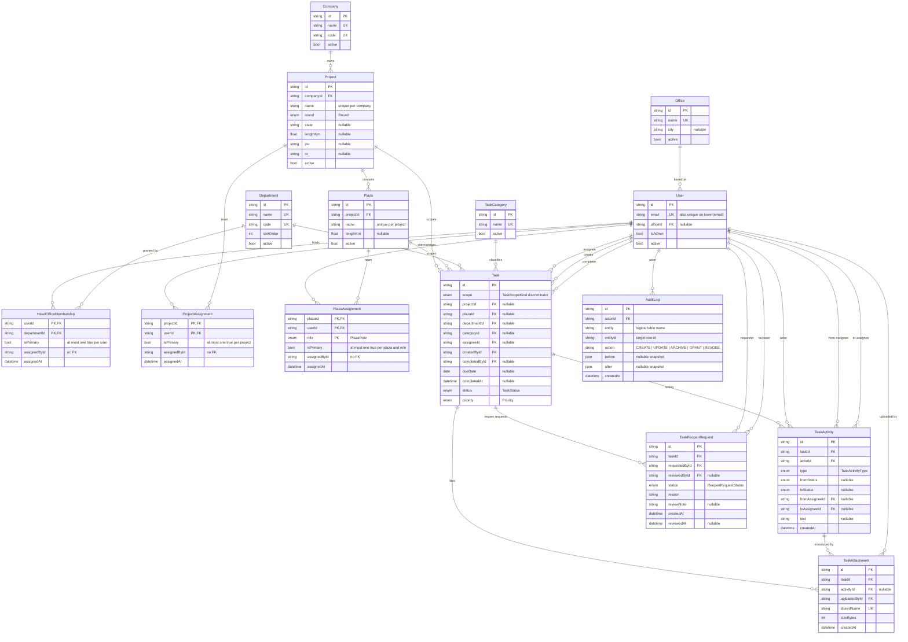
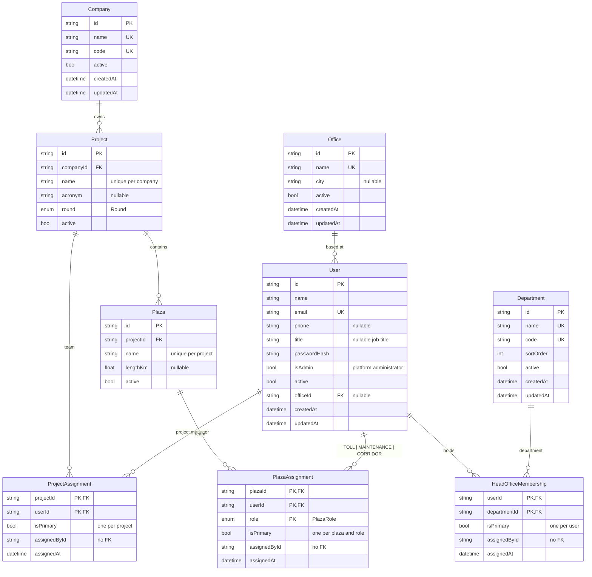
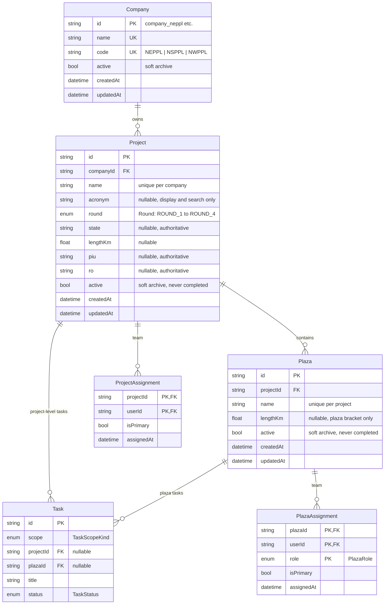
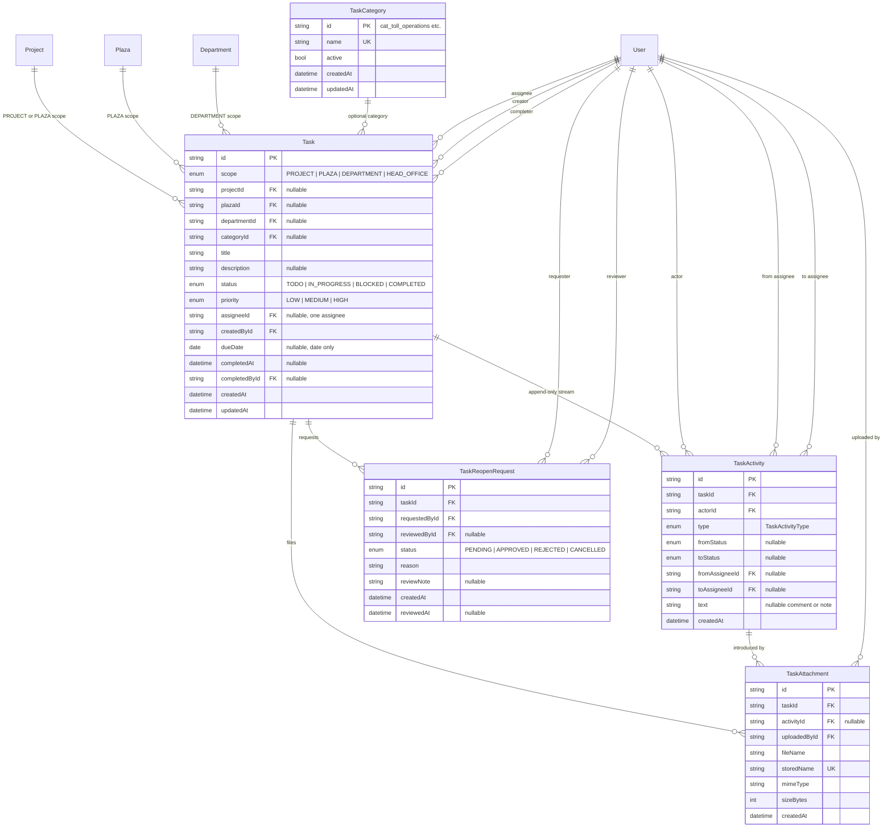
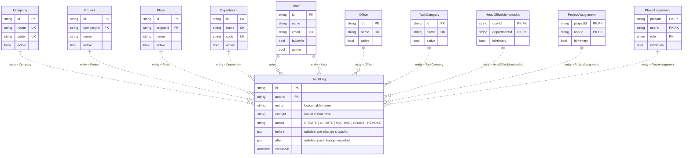

# Entity–Relationship Diagram — Project Site Tracker

This document is the **shape** of the database: every table, every relationship,
the cardinality that the foreign keys actually enforce, and the handful of
invariants that live only in SQL. It describes the database **as built by the
migrations**, not the idealised model.

* Column-level detail (type, nullability, default, index) lives in
  [`SCHEMA.md`](./SCHEMA.md).
* The intended design and the access rules live in [`DATABASE.md`](./DATABASE.md).
* Why the schema looks like this, and what was cleaned up in Phase 1 + 2, is in
  [`DATABASE-AUDIT.md`](./DATABASE-AUDIT.md).

Table and column names are the real PostgreSQL identifiers (`"Task"`,
`"projectId"`). Prisma model names match them exactly — there is no `@@map`.

---

## How to read the diagrams

The diagrams use Mermaid `erDiagram`, which GitHub renders inline. Read a
relationship right-to-left as a sentence:

```
Company ||--o{ Project : "owns"
```

| Symbol | Meaning |
|---|---|
| `\|\|` | exactly one |
| `o\|` | zero or one |
| `}o` | zero or more |
| `}\|` | one or more |

So the line above reads *"one Company owns zero or more Projects; each Project
belongs to exactly one Company."* The label is free text, not a column name.

Inside an entity block:

* `PK` = primary key, `FK` = foreign key, `UK` = unique.
* Types are simplified to `string`, `int`, `float`, `bool`, `date`, `datetime`,
  `json`, `enum`. The real PostgreSQL types are in [`SCHEMA.md`](./SCHEMA.md).
* A quoted comment is a note, not part of the type.

Mermaid `erDiagram` has no subgraph syntax, so the models are grouped by
declaration order and separated with `%%` comments. Relationship labels on the
same pair of entities (for example `User` → `Task` three times) are distinct
foreign keys, not duplicates.

---

## 1. Full model

All 15 models and all 27 foreign-key relationships. Key columns only; see the
focused diagrams below and [`SCHEMA.md`](./SCHEMA.md) for the rest.



---

## 2. People and access

Access is derived, never stored as a role column: `User.isAdmin` plus the
assignment rows a person holds. Head Office is **global** — one membership
covers every company — while project and plaza assignments are scoped.



Notes:

* `HeadOfficeMembership` is keyed by `(userId, departmentId)` — a person can
  belong to several departments, and every row is a full Head Office grant.
* `ProjectAssignment` is keyed by `(projectId, userId)`;
  `PlazaAssignment` by `(plazaId, userId, role)`, so one person can hold
  `TOLL`, `MAINTENANCE` and `CORRIDOR` on the same plaza.
* `assignedById` on all three assignment tables is a **plain text column with
  no foreign key**. It records who granted the row for display only.
* The `isPrimary` flags are not a normal column semantics: partial unique
  indexes enforce at most one `true` per user / project / plaza+role (see
  [constraints](#7-constraints-worth-knowing)). "Exactly one" is maintained by
  the API inside a transaction.

---

## 3. Company → Project → Plaza delivery hierarchy

The only true ownership hierarchy in the model. Company owns projects, projects
contain plazas; tasks hang off projects and plazas.



Notes:

* `Plaza` deliberately has **no** `state`, `piu` or `ro`; those were dropped in
  `20261029000002_scope_audit_locations` and are read through `plaza.project`.
  Only `lengthKm` (the plaza bracket) is plaza-specific.
* `Project.lengthKm` still exists and is nullable; the seed leaves it blank
  because plaza brackets are authoritative.
* Uniqueness ignores `active`: archiving a plaza keeps its name reserved within
  the project, and archiving a project keeps its name reserved within the
  company.
* There is no lifecycle status. `active = false` means archived, and the
  `Restrict` foreign keys stop a project or plaza from being deleted while
  children exist.

---

## 4. Tasks, history, attachments and the reopen workflow

A task has exactly one scope, selected by `Task.scope`. History is append-only:
comments are `TaskActivity` rows with `type = COMMENT`. Reopening a completed
task is a request/approval row, not an edit to the task.



Scope matrix enforced by `Task_scope_kind_check`:

| `scope` | `projectId` | `plazaId` | `departmentId` | Meaning |
|---|---|---|---|---|
| `PROJECT` | set | null | null | project-level task |
| `PLAZA` | set | set | null | plaza task |
| `DEPARTMENT` | null | null | set | Head Office department task |
| `HEAD_OFFICE` | null | null | null | Head Office level task |

Notes:

* The CHECK enforces the **combination**, not that `Task.plaza.projectId`
  equals `Task.projectId`. "The plaza belongs to the project" is an API
  invariant only — see [open questions](#9-open-questions).
* `TaskActivity` and `TaskReopenRequest` cascade with the task;
  `TaskAttachment` cascades with the task but only loses its `activityId`
  (`SetNull`) when an activity is removed.
* Every user reference is `Restrict` after
  `20261029000000_integrity` — people are deactivated, never deleted.
* At most one `PENDING` reopen request exists per task, enforced by a partial
  unique index rather than by the application alone.

---

## 5. Master-data audit

`AuditLog` is one row per master-data mutation, with JSON snapshots. The
relationship to the audited row is **logical** (`entity` + `entityId` strings),
not a foreign key — which is why the lines below are non-identifying (`..`).
Task history does not go here; it stays in `TaskActivity`.



Notes:

* `entity` is free text, not an enum. Documented values are the model names
  above; nothing at the database level restricts the set.
* `action` is free text too. The documented vocabulary is
  `CREATE`, `UPDATE`, `ARCHIVE`, `GRANT`, `REVOKE`.
* `before` / `after` are `JSONB`. `before` is null on `CREATE`/`GRANT`,
  `after` is null on `REVOKE` and on hard deletes if one ever happens.
* User snapshots must never contain `passwordHash`; a reset records
  `passwordChanged: true` instead.
* `AuditLog.actorId` is `Restrict`, so the trail cannot lose its actor. There is
  no update or delete API.

---

## 6. Relationship and cardinality

Every foreign key in the database, with its delete behaviour. All 27 are
`ON UPDATE CASCADE`; only `ON DELETE` differs. `Restrict` is the default for
anything that would lose history; `Cascade` is limited to grants and task
children.

| # | Parent → Child | Cardinality | FK column(s) | onDelete / onUpdate | Notes |
|---|---|---|---|---|---|
| 1 | `Office` → `User` | 1 : 0..N | `User.officeId` | `SET NULL` / `CASCADE` | office is optional metadata |
| 2 | `Company` → `Project` | 1 : 0..N | `Project.companyId` | `RESTRICT` / `CASCADE` | a company cannot be deleted while it owns projects |
| 3 | `Project` → `Plaza` | 1 : 0..N | `Plaza.projectId` | `RESTRICT` / `CASCADE` | archive the project instead of deleting it |
| 4 | `User` → `HeadOfficeMembership` | 1 : 0..N | `HeadOfficeMembership.userId` | `CASCADE` / `CASCADE` | PK part of `(userId, departmentId)` |
| 5 | `Department` → `HeadOfficeMembership` | 1 : 0..N | `HeadOfficeMembership.departmentId` | `CASCADE` / `CASCADE` | PK part; a department delete removes its grants |
| 6 | `Project` → `ProjectAssignment` | 1 : 0..N | `ProjectAssignment.projectId` | `CASCADE` / `CASCADE` | PK part of `(projectId, userId)` |
| 7 | `User` → `ProjectAssignment` | 1 : 0..N | `ProjectAssignment.userId` | `CASCADE` / `CASCADE` | PK part; grants are not history |
| 8 | `Plaza` → `PlazaAssignment` | 1 : 0..N | `PlazaAssignment.plazaId` | `CASCADE` / `CASCADE` | PK part of `(plazaId, userId, role)` |
| 9 | `User` → `PlazaAssignment` | 1 : 0..N | `PlazaAssignment.userId` | `CASCADE` / `CASCADE` | PK part |
| 10 | `Project` → `Task` | 1 : 0..N | `Task.projectId` | `RESTRICT` / `CASCADE` | set for `PROJECT` and `PLAZA` scopes |
| 11 | `Plaza` → `Task` | 1 : 0..N | `Task.plazaId` | `RESTRICT` / `CASCADE` | set for `PLAZA` scope only |
| 12 | `Department` → `Task` | 1 : 0..N | `Task.departmentId` | `RESTRICT` / `CASCADE` | set for `DEPARTMENT` scope only |
| 13 | `TaskCategory` → `Task` | 1 : 0..N | `Task.categoryId` | `SET NULL` / `CASCADE` | deleting a category keeps its tasks |
| 14 | `User` → `Task` (assignee) | 1 : 0..N | `Task.assigneeId` | `RESTRICT` / `CASCADE` | nullable; one assignee per task |
| 15 | `User` → `Task` (creator) | 1 : 0..N | `Task.createdById` | `RESTRICT` / `CASCADE` | not null on the child; every task has a creator |
| 16 | `User` → `Task` (completer) | 1 : 0..N | `Task.completedById` | `RESTRICT` / `CASCADE` | nullable; set with `completedAt` |
| 17 | `Task` → `TaskActivity` | 1 : 0..N | `TaskActivity.taskId` | `CASCADE` / `CASCADE` | append-only stream; cascades only with the task |
| 18 | `User` → `TaskActivity` (actor) | 1 : 0..N | `TaskActivity.actorId` | `RESTRICT` / `CASCADE` | not null |
| 19 | `User` → `TaskActivity` (from assignee) | 1 : 0..N | `TaskActivity.fromAssigneeId` | `RESTRICT` / `CASCADE` | nullable, `ASSIGNED` rows |
| 20 | `User` → `TaskActivity` (to assignee) | 1 : 0..N | `TaskActivity.toAssigneeId` | `RESTRICT` / `CASCADE` | nullable, `ASSIGNED` rows |
| 21 | `Task` → `TaskAttachment` | 1 : 0..N | `TaskAttachment.taskId` | `CASCADE` / `CASCADE` | files disappear with the task |
| 22 | `TaskActivity` → `TaskAttachment` | 1 : 0..N | `TaskAttachment.activityId` | `SET NULL` / `CASCADE` | nullable; the file survives its activity |
| 23 | `User` → `TaskAttachment` (uploader) | 1 : 0..N | `TaskAttachment.uploadedById` | `RESTRICT` / `CASCADE` | not null |
| 24 | `Task` → `TaskReopenRequest` | 1 : 0..N | `TaskReopenRequest.taskId` | `CASCADE` / `CASCADE` | at most one `PENDING` per task |
| 25 | `User` → `TaskReopenRequest` (requester) | 1 : 0..N | `TaskReopenRequest.requestedById` | `RESTRICT` / `CASCADE` | not null |
| 26 | `User` → `TaskReopenRequest` (reviewer) | 1 : 0..N | `TaskReopenRequest.reviewedById` | `RESTRICT` / `CASCADE` | nullable |
| 27 | `User` → `AuditLog` (actor) | 1 : 0..N | `AuditLog.actorId` | `RESTRICT` / `CASCADE` | the trail cannot lose its actor |

Non-foreign-key links, listed so they are not mistaken for FKs:

| Link | How it is stored | Why |
|---|---|---|
| `AuditLog` → any audited row | `entity` + `entityId` text columns | one log table for every model; no per-entity FK |
| `HeadOfficeMembership` / `ProjectAssignment` / `PlazaAssignment` → `User` (granter) | `assignedById` text column | records who granted the row for display; not enforced |
| `Task` → its scope | `scope` enum plus three nullable FK columns | combination enforced by `Task_scope_kind_check` |

---

## 7. Constraints worth knowing

Every name below was checked against `prisma/migrations/*/migration.sql`. These
objects are **not expressible in `schema.prisma`**, so they exist only in the
migration history — a squash would silently lose them.

| Object | Kind | Definition (semantics) | Migration |
|---|---|---|---|
| `Task_scope_kind_check` | CHECK | `scope` must match exactly one non-null location column set (see matrix in §4) | `20261029000002_scope_audit_locations` |
| `HeadOfficeMembership_userId_primary_key` | partial unique | `UNIQUE ("userId") WHERE "isPrimary"` — at most one primary department per user | `20261023000000_head_office_departments` |
| `ProjectAssignment_projectId_primary_key` | partial unique | `UNIQUE ("projectId") WHERE "isPrimary"` — at most one lead PM per project | `20261029000000_integrity` |
| `PlazaAssignment_plazaId_role_primary_key` | partial unique | `UNIQUE ("plazaId", "role") WHERE "isPrimary"` — at most one lead per plaza + role | `20261029000000_integrity` |
| `TaskReopenRequest_taskId_pending_key` | partial unique | `UNIQUE ("taskId") WHERE "status" = 'PENDING'` — at most one pending reopen request per task | `20261021000000_init` |
| `User_email_lower_key` | functional unique | `UNIQUE (lower("email"))` — case-insensitive email, matching the API which lowercases on write | `20261029000000_integrity` |
| `User_email_key` | unique | `UNIQUE ("email")` — the plain exact-match unique index, still present | `20261021000000_init` |
| `Project_companyId_name_key` | unique composite | `UNIQUE ("companyId", "name")` | `20261021000000_init` |
| `Plaza_projectId_name_key` | unique composite | `UNIQUE ("projectId", "name")` | `20261021000000_init` |
| `Company_name_key`, `Company_code_key` | unique | one row per company name / code | `20261021000000_init` |
| `Department_name_key`, `Department_code_key` | unique | one row per department name / code | `20261023000000_head_office_departments` |
| `Office_name_key` | unique | one row per office name | `20261023000000_head_office_departments` |
| `TaskCategory_name_key` | unique | one row per category name | `20261021000000_init` |
| `TaskAttachment_storedName_key` | unique | one row per stored file | `20261021000000_init` |

Two CHECK constraints were **superseded** and no longer exist:

| Object | Status | Replaced by |
|---|---|---|
| `Task_scope_at_most_one` | dropped in `20261029000002` | `Task_scope_kind_check` |
| `Task_plaza_requires_project` | dropped in `20261029000002` | `Task_scope_kind_check` |

`Task_scope_kind_check` is currently the **only** CHECK constraint in the
database. There are no CHECKs on `TaskActivity` per-type column validity, on
`Round`, or on `Company.code`.

The raw SQL for each is reproduced in
[`SCHEMA.md` § Constraints](./SCHEMA.md#constraints).

---

## 8. Conventions

### IDs

| Kind | Convention | Examples |
|---|---|---|
| Generated rows (users, projects, plazas, tasks, assignments, activities, attachments, reopen requests, audit rows) | Prisma `cuid()` — client-side default, so raw SQL must supply an id | `clx8f3…` |
| Reference/catalogue rows (companies, departments, offices, task categories) | Stable slug owned by the seed; rewritten by `20261029000002` | `company_neppl`, `dept_fin`, `dept_hr-ld`, `office_delhi`, `cat_toll_operations` |

Slug rules, as implemented:

* Company: `company_` + lower(`code`) with non-alphanumerics collapsed to `-`.
* Department: `dept_` + lower(`code`), same collapsing (`HR-LD` → `dept_hr-ld`).
* Office: `office_` + lower(`name`).
* Task category: `cat_` + lower(`name`) with non-alphanumerics collapsed to `_`
  (`Toll Operations` → `cat_toll_operations`).

Because every FK is `ON UPDATE CASCADE`, the Phase 2 `UPDATE … SET id = …` pass
re-pointed children without breaking links. Validation uses one shared
`idSchema` (`z.string().min(1).max(64)`), not `.cuid()`.

### Timestamps and dates

* Every audit timestamp is `TIMESTAMPTZ(3)` — millisecond precision, stored in
  UTC, rendered in `APP_TIME_ZONE`. `20261029000000_integrity` converted all
  `TIMESTAMP(3)` columns; new tables are created as `TIMESTAMPTZ(3)`.
* `createdAt` defaults to `CURRENT_TIMESTAMP`. `updatedAt` has **no database
  default** — Prisma's `@updatedAt` writes it from the client. `Office` briefly
  had a default for the backfill; `20261029000001_office_updated_at` dropped it.
* `Task.dueDate` is a PostgreSQL `DATE`, not a timestamp: no time, no zone.
  Overdue comparisons happen in `lib/dates.ts`, not in SQL.
* Calendar-style fields (`assignedAt`, `reviewedAt`, `completedAt`) are
  timestamps, not dates.

### Soft archive

* `active BOOLEAN NOT NULL DEFAULT true` exists on `User`, `Company`,
  `Department`, `Office`, `Project`, `Plaza`, `TaskCategory`.
* Master data is archived (`active = false`), never deleted while referenced.
  Projects and plazas have **no** lifecycle status and never "complete".
* `active` is not part of any unique index, so an archived row keeps its name
  reserved. Reusing a name requires editing the archived row.
* People are never deleted at all: deactivation is the only removal path, and
  every user FK is `Restrict`. Cascades exist only for *assignment* rows
  (`HeadOfficeMembership`, `ProjectAssignment`, `PlazaAssignment`), which are
  grants rather than history.

---

## 9. Open questions

Points where the schema, the migrations and the prose documentation do not
fully agree. Documented as-is; not changed.

1. **Plaza must belong to the task's project.** `DATABASE.md` says a `PLAZA`
   task's plaza belongs to the project. No constraint enforces
   `Task.plaza.projectId = Task.projectId` — only the API does. Adding it would
   need a composite FK or a trigger.
2. **`TaskActivity` per-type column validity.** `DATABASE-AUDIT.md` P-18 noted
   that nothing prevents a `COMMENT` row from carrying status transitions, or a
   `STATUS_CHANGED` row from having no statuses. Still unenforced.
3. **`assignedById` has no foreign key** on `HeadOfficeMembership`,
   `ProjectAssignment` and `PlazaAssignment`, although it stores a user id. A
   deleted or mistyped id leaves a dangling reference. (Users are `Restrict`
   elsewhere, so this is mostly theoretical.)
4. **`AuditLog.entity` / `action` are unconstrained text.** The documented
   vocabulary is enforced only by the writers in `lib/audit.ts`.
5. **`docs/DATABASE-AUDIT.md` §1 is stale.** It says "14 models, 6 enums" and
   "4 files" of migration history; the database now has 15 models, 7 enums and
   7 migrations. It is a historical record dated 2026-10-29, so it was left
   untouched.
6. **`Project.lengthKm` is retained but unused.** `DATABASE-AUDIT.md` §5.2 said
   to keep it only if a real project total exists. It still exists (nullable)
   and the seed leaves it blank.
7. **Production migration state is unverified.** `DATABASE-AUDIT.md` §2.2 says
   production is *probably* on the baseline four migrations. The three
   `20261029*` migrations are confirmed applied in dev only.
