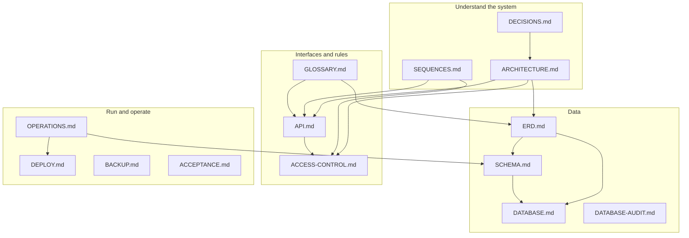

# Documentation

Project Site Tracker is a pilot web app for tracking toll-plaza site work across
three companies, plus Head Office work scoped to a department. This folder is the
documentation set: architecture, data model, API, access rules, operational
runbooks and the decisions behind them.

Start with the path that matches your task.

| If you need to… | Read |
|---|---|
| Understand the system end to end | [ARCHITECTURE.md](ARCHITECTURE.md) |
| See the data model as a picture | [ERD.md](ERD.md) |
| Look up a column, type or index | [SCHEMA.md](SCHEMA.md) |
| Understand the intended database design | [DATABASE.md](DATABASE.md) |
| Call or change an endpoint | [API.md](API.md) |
| Check who can do what | [ACCESS-CONTROL.md](ACCESS-CONTROL.md) |
| Follow a flow step by step | [SEQUENCES.md](SEQUENCES.md) |
| Run, deploy, back up or troubleshoot | [OPERATIONS.md](OPERATIONS.md) |
| Know why something is the way it is | [DECISIONS.md](DECISIONS.md) |
| Decode a term or acronym | [GLOSSARY.md](GLOSSARY.md) |

## Documentation map



## Core reference

| Document | What it covers | Status |
|---|---|---|
| [ARCHITECTURE.md](ARCHITECTURE.md) | System context, containers, component map, request lifecycle, auth, deployment topology, trade-offs | Current |
| [ERD.md](ERD.md) | Full and per-domain entity-relationship diagrams, cardinalities, constraints | Current |
| [SCHEMA.md](SCHEMA.md) | Column-level data dictionary, enums, indexes, CHECK constraints, migration history | Current |
| [DATABASE.md](DATABASE.md) | Intended database design, hierarchy, permission model, seed profile | Current |
| [DATABASE-AUDIT.md](DATABASE-AUDIT.md) | The 2026-10 audit: findings, phases and applied changes | Historical + applied record |
| [API.md](API.md) | Endpoint index, auth, payloads, responses, errors, validation | Current |
| [ACCESS-CONTROL.md](ACCESS-CONTROL.md) | Derived roles, visibility, capability matrix, assignment ceiling, edge cases | Current |
| [SEQUENCES.md](SEQUENCES.md) | Sequence diagrams for login, task lifecycle, reopen, uploads, audit | Current |
| [OPERATIONS.md](OPERATIONS.md) | Environments, env vars, migrations, seed, deploy, backup, incidents | Current |
| [DECISIONS.md](DECISIONS.md) | ADR-style record of the design decisions | Current |
| [GLOSSARY.md](GLOSSARY.md) | Domain and technical terms, acronyms | Current |

## Operations and delivery

| Document | What it covers |
|---|---|
| [DEPLOY.md](DEPLOY.md) | Pilot VM deployment, Docker Compose stack, one-time baseline reset |
| [BACKUP.md](BACKUP.md) | `pg_dump` backup and restore drill |
| [ACCEPTANCE.md](ACCEPTANCE.md) | Pilot sign-off checklist |
| [master-data.md](master-data.md) | Source list for companies, projects, plazas and people |

## Historical material

These are kept for context and are **not** the current source of truth:

- `../plan.md` — original v1 build spec, superseded.
- `../TASKS.md` — original task breakdown, superseded.
- [head-office-departments-plan.md](head-office-departments-plan.md) — design
  note for the department/office model.
- [head-office-task-scope-plan.md](head-office-task-scope-plan.md) — design note
  for Head Office task scope.

## Diagrams

All diagrams are [Mermaid](https://mermaid.js.org/) fenced code blocks, so they
render on GitHub, GitLab, VS Code (Markdown Preview Mermaid Support) and most
Markdown viewers. They are deliberately text-first: a diagram can be reviewed in
a pull request like any other code.

| Where | Diagrams |
|---|---|
| [ARCHITECTURE.md](ARCHITECTURE.md) | System context, containers, component map, deployment |
| [ERD.md](ERD.md) | Full ERD plus people/access, delivery hierarchy, task history and audit views |
| [SEQUENCES.md](SEQUENCES.md) | Login, page load, task list, task creation, assignment, status change, reopen, upload, audit, access update |
| [DATABASE.md](DATABASE.md) | High-level entity diagram |
| This page | Documentation map |

If your viewer does not render Mermaid, the surrounding prose and tables carry
the same information; the diagrams are a reading aid, not the only source.

## Conventions

- **Source of truth for the schema** is `prisma/schema.prisma` plus the applied
  migrations. `DATABASE.md` and `ERD.md` describe the intent; `SCHEMA.md` mirrors
  the columns. If they disagree, the database wins and the docs need a fix.
- **Source of truth for behaviour** is the code under `app/`, `lib/` and
  `middleware.ts`. API and access docs are checked against the route handlers.
- **Dates** are stored as `timestamptz(3)` (instants) or `date` (calendar days).
  User-facing day boundaries use `Asia/Kolkata` via `lib/dates.ts`.
- **Ids** are opaque strings: generated rows use `cuid()`, catalogue rows use
  stable slugs (`company_neppl`, `dept_fin`, `office_delhi`, `cat_toll_operations`).
- **Never** put a real password, token or personal data in these docs. Seeded
  demo credentials are called out as demo-only.

## Keeping docs current

When a change affects the schema, API, access rules or deployment:

1. Update the code and migration first.
2. Update `SCHEMA.md` and `ERD.md` for data changes.
3. Update `API.md` and `ACCESS-CONTROL.md` for behaviour changes.
4. Update `SEQUENCES.md` / `ARCHITECTURE.md` if a flow or component changed.
5. Add or supersede an ADR in `DECISIONS.md` for a design decision.
6. Run the docs link check (see below) and, if you touched diagrams, preview
   them in a Mermaid-capable viewer.

## Checking links

From the repository root:

```powershell
node scripts/check-docs-links.mjs
```

The script resolves relative Markdown links inside `docs/` and fails on a
missing target. (If the script is not present in your checkout, the links in
this page are still plain relative paths you can follow manually.)
