# Sequences — Project Site Tracker

Step-by-step views of the flows that matter. Each section names the exact files
and functions involved, so a diagram can be checked against the code.

* Runtime shape: [`ARCHITECTURE.md`](./ARCHITECTURE.md)
* Permissions used below: [`ACCESS-CONTROL.md`](./ACCESS-CONTROL.md)
* Request/response shapes: [`API.md`](./API.md)

All diagrams are Mermaid `sequenceDiagram` blocks and render on GitHub.

---

## 1. Login and JWT issuance

**When:** a user submits the credentials form on `/login`.

The login path is the only place a password is checked. It is also the only
place the in-memory rate limiter is used.

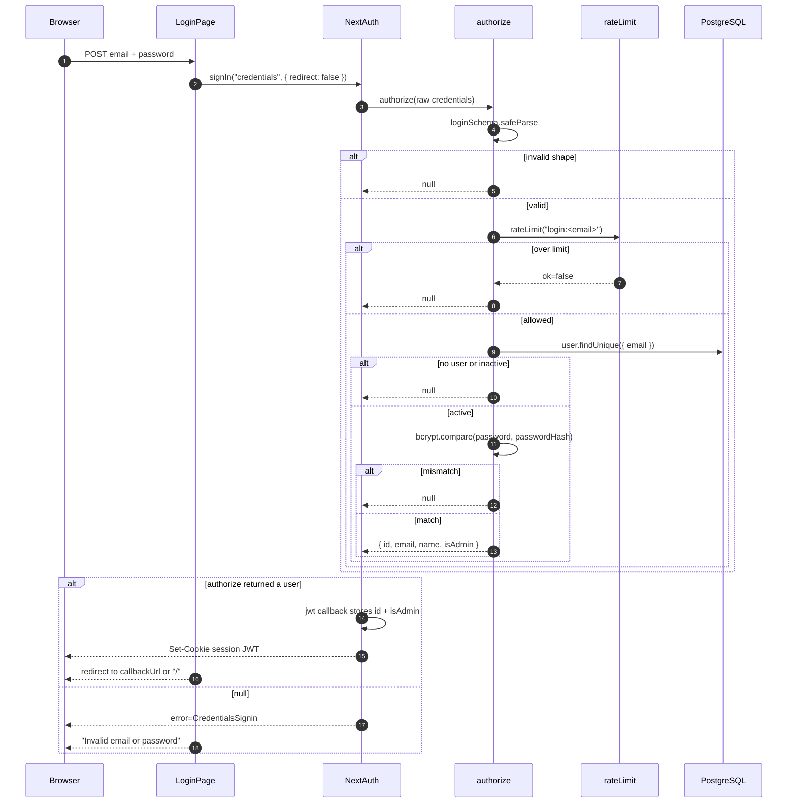

**Implementation notes**

* `app/(auth)/login/page.tsx` — client form; calls `signIn` from `next-auth/react`.
* `lib/auth.ts` — `Credentials({ authorize })`; `rateLimit` before the DB query;
  `bcrypt.compare`; returns `null` on any failure so the error is generic.
* `lib/auth.config.ts` — `session.strategy = "jwt"`, `pages.signIn = "/login"`,
  `trustHost: true`; the `jwt` callback copies `id` and `isAdmin` onto the token.
* `lib/rate-limit.ts` — 5 attempts per 60 s per email, in memory. It is keyed by
  email only (the comment says "IP + email", the call site passes email).
* No audit row is written for login/logout.

---

## 2. Authenticated page load

**When:** any page under `app/(app)` is requested.

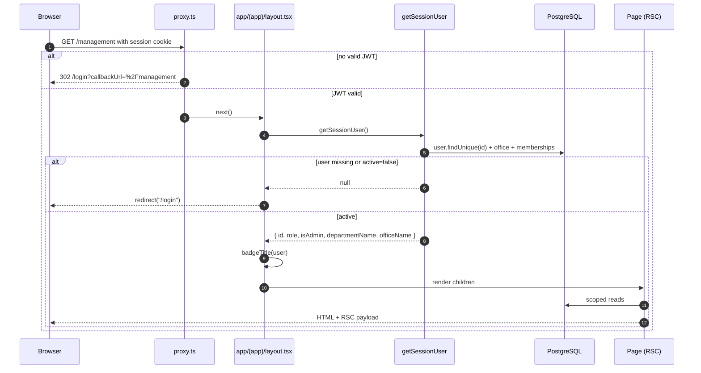

**Implementation notes**

* `proxy.ts` — `auth()` from the edge-safe config. Public paths: `/login`,
  `api/auth`, `api/health`, `_next`, `favicon`. API requests get
  `{"error":"Unauthorized"}` with `401`; pages get a redirect.
* `app/(app)/layout.tsx` — calls `getSessionUser()` and redirects when null;
  renders `AppHeader` with the display role and `badgeTitle`.
* `lib/access.ts#getSessionUser` — re-reads `active`, `isAdmin`, office and
  memberships. The display role is `ADMIN` → `HEAD_OFFICE` → `PROJECT_MANAGER`.
* `lib/badge.ts#badgeTitle` — Admin/HO show their level (HO also the primary
  department); project users show "Project Manager" when they manage a project,
  otherwise their plaza job titles.
* `app/page.tsx` — `/` redirects Admin/HO to `/management`, everyone else to
  `/my-work`.

---

## 3. Task list with scope filtering

**When:** a workspace loads its task list, or the user changes a filter.

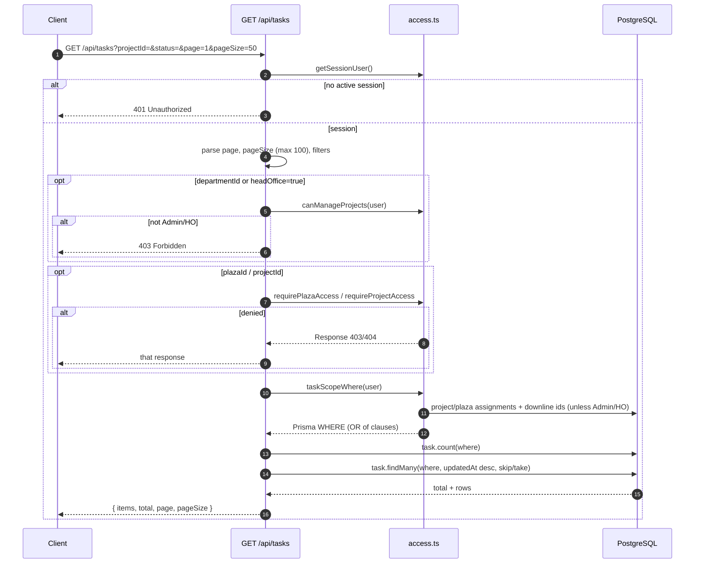

**Implementation notes**

* `app/api/tasks/route.ts#GET` — all filter parsing and the `AND` of
  `taskScopeWhere(user)` plus explicit constraints.
* Filters: `plazaId`, `projectId`, `departmentId`, `headOffice=true`, `status`,
  `priority`, `categoryId`, `assigneeId` (`me` resolves to the caller),
  `overdue=true`, `q` (title or assignee name, case-insensitive), `page`,
  `pageSize`.
* `overdue=true` adds `dueDate < todayIst()` **and** `status != COMPLETED`; it
  overrides `status`.
* `lib/access.ts#taskScopeWhere` — Admin/HO get `{}`; otherwise the union of
  project assignments, plaza assignments, tasks assigned to the caller, tasks
  they created, and tasks assigned to or created by their downline.
* Ordering is `updatedAt desc`; there is no configurable sort.

---

## 4. Task creation (single scope)

**When:** a user submits the command composer with one location.

```mermaid
sequenceDiagram
  autonumber
  participant C as Client
  participant R as POST /api/tasks
  participant A as access.ts
  participant D as PostgreSQL

  C->>R: { projectId? plazaId? departmentId?, title, assigneeIds: [...], ... }
  R->>A: getSessionUser()
  alt no session
    R-->>C: 401
  else session
    R->>R: createTaskSchema.safeParse(body)
    alt invalid (bad shape, more than 20 assignee ids)
      R-->>C: 400 Invalid input + issues
    else valid
      R->>R: de-duplicate assigneeIds; assigneeId alias → [assigneeId]
      R->>D: category lookup (if categoryId)
      alt category missing or inactive
        R-->>C: 422 Category not found or inactive
      end
      R->>D: resolveScope()
      alt referenced project/plaza/department missing
        R-->>C: 404
      else inactive department
        R-->>C: 422 Department is not active
      else plaza not in project
        R-->>C: 422 Plaza does not belong to the selected project
      end
      R->>A: canCreateTask(user, scope)
      alt not allowed
        R-->>C: 403 Forbidden
      end
      R->>A: actorScopeRole(user, scope)
      alt no role in scope
        R-->>C: 403 Forbidden
      end
      loop each assigneeId
        R->>A: canAssignTo(actorRole, scope, assigneeId)
        alt not allowed
          R-->>C: 422 That person cannot be assigned in this scope
        end
      end
      R->>D: $transaction
      D->>D: task.create(scope, columns, createdBy, assignees: create[])
      D->>D: taskActivity CREATED
      loop each assignee
        D->>D: taskActivity ASSIGNED (toAssigneeId)
      end
      D-->>R: task with includes
      R-->>C: 201 task JSON { assignees: [{ id, name, assignedAt }] }
    end
  end
```

**Implementation notes**

* `app/api/tasks/route.ts#POST` — detects batch mode by the presence of a
  `scopes` array; otherwise validates with `createTaskSchema`.
* `assigneeIds` is optional, capped at `MAX_TASK_ASSIGNEES` (20) and
  de-duplicated by the schema transform. `assigneeId` is a deprecated alias for
  a one-element list; when both are absent the task is created unassigned.
* `resolveScope()` — department first, then plaza (resolving its project), then
  project, otherwise Head Office level (`scope = HEAD_OFFICE`, no location
  columns).
* `scopeAccessError()` — combines `canCreateTask`, `actorScopeRole` and one
  `canAssignTo` check per requested assignee.
* `createScopedTask()` — writes `Task` + one `TaskAssignee` row per assignee
  (`assignedById` = caller) + a `CREATED` activity (its `toAssigneeId` is the
  first assignee), then one `ASSIGNED` activity per assignee. The activity text
  varies by scope ("Project-level task created", "Department task created ·
  Finance", …).
* `scopeKindOf()` — stores `DEPARTMENT`, `PLAZA`, `PROJECT` or `HEAD_OFFICE` in
  `Task.scope`, matching the DB CHECK.
* Due date is parsed as `new Date("YYYY-MM-DDT00:00:00Z")`, i.e. UTC midnight.

### 4.1 Batch creation

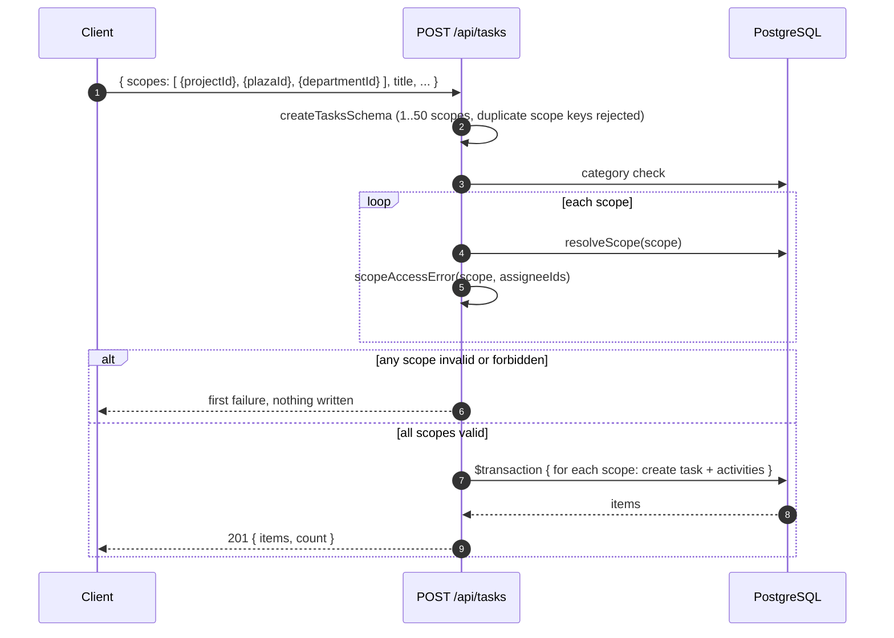

**Implementation notes**

* All scopes are resolved and authorised **before** the transaction opens, so a
  single bad scope writes nothing.
* `batchScopeKey()` de-duplicates by `department:<id>`, `plaza:<id>`,
  `project:<id>` or `head-office`.
* The same title, description, priority, due date, category and assignee set
  are applied to every created task.

---

## 5. Assignment with the ceiling

**When:** a user changes the team on a task — adds people, removes people, or
clears the set.

The endpoint is a **replace-set**: the body is the complete desired assignee
list, not a single change.

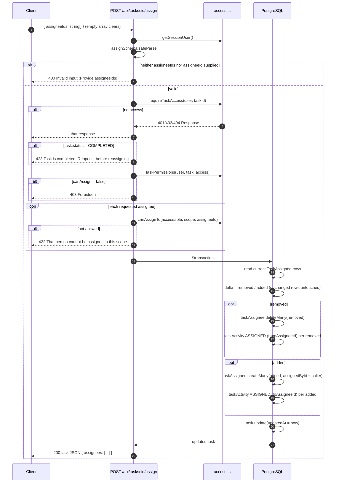

**Implementation notes**

* `app/api/tasks/[id]/assign/route.ts`.
* `assignSchema` — `assigneeIds` (max 20, de-duplicated) plus the deprecated
  `assigneeId` alias; a request must carry one of them. An empty array clears
  every assignee.
* Replace-set semantics: unchanged rows are left alone, so their `assignedAt`
  survives. Only the delta is written, and there is exactly one `ASSIGNED`
  activity per person added or removed (`fromAssigneeId` or `toAssigneeId`).
* `Task.updatedAt` is touched even when the set did not change, so
  `updatedAt desc` lists stay accurate.
* `taskPermissions().canAssign` — false when completed and false when the caller
  has no scope role (`access.scopeRole === null`), so a manager-only observer
  cannot reassign. For Head Office tasks (department or Head Office level) only
  Admin/HO may assign; project tasks keep the normal ceiling.
* `lib/access.ts#canAssignTo` — Admin/HO may assign any active user at any
  scope; department scope is Admin/HO only; a PM may assign Admin, HO, project
  PMs and site managers in the project; a site manager may assign the project PM
  and site managers on the same plaza, never Admin/HO.
* `targetRoleOnScope()` is the target-side check: active user, Admin, any HO
  membership (global), project assignment on the project, or plaza assignment on
  the plaza (any plaza in the project when the task is project-level).
* Clearing the assignees is always allowed by the ceiling check (the loop does
  not run for an empty array) but still requires `canAssign`.

---

## 6. Manager visibility and status (reporting line)

**When:** a junior creates a task, or is assigned one, and their manager has no
project or plaza grant covering it. The reporting line (`User.managerId`) is the
only link between them.

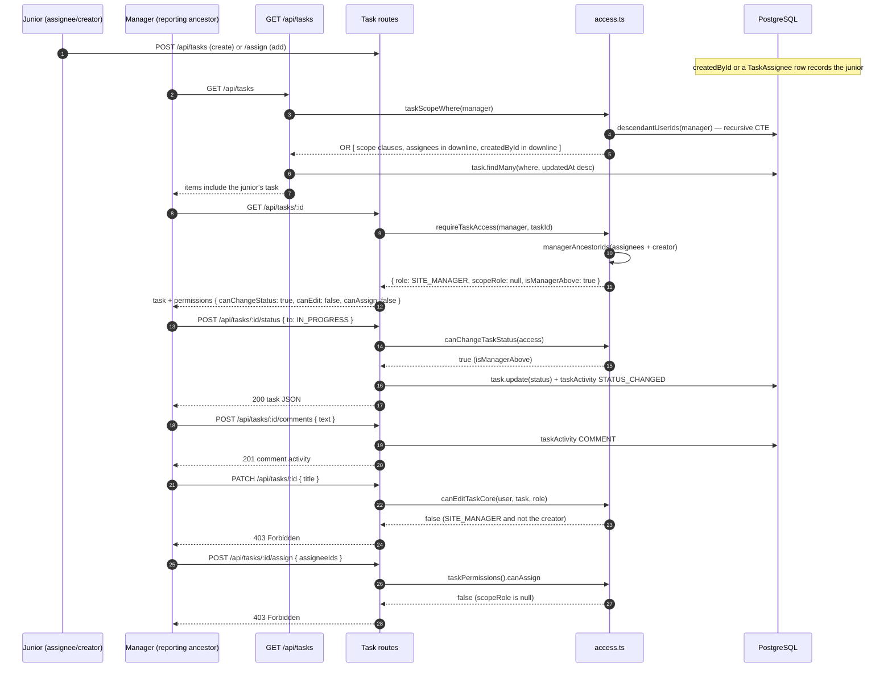

**Implementation notes**

* `lib/access.ts#descendantUserIds` — everyone below the caller in the reporting
  chain, at any depth. The `WITH RECURSIVE` CTE uses `UNION` (not `UNION ALL`),
  so a bad manager link cannot loop forever.
* Visibility is additive: the existing project/plaza/own-work clauses plus
  "assigned to or created by anyone in the downline". `accessibleProjectIds`,
  `accessiblePlazaIds`, `requireProjectAccess` and `requirePlazaAccess` use the
  same downline, so the project and plaza pages open as well.
* `resolveTaskAccess` — access comes from a global role, a scope role, being an
  assignee or creator, or being a manager above. Manager-only access returns
  `role: "SITE_MANAGER"` with `scopeRole: null` and `isManagerAbove: true`; a
  manager who also holds a project or plaza assignment keeps that role instead.
* Status: `canChangeTaskStatus` allows an assignee, the creator, a manager-chain
  ancestor, or Admin/Head Office/Project Manager. A same-plaza site-manager peer
  can view and comment but gets `403` from the status route.
* Edit and reassign: `canEditTaskCore` needs Admin/HO/PM or the creator, and
  `taskPermissions().canAssign` needs a scope role — so manager-only access
  grants neither. Comments and uploads are open to anyone `requireTaskAccess`
  admits.
* `lib/reporting.ts#managerCycleError` rejects a self-manager and any link that
  would close a cycle with `422`; it also rejects an inactive or missing
  manager.

---

## 7. Status change

**When:** a user moves a task between TODO, IN_PROGRESS, BLOCKED and COMPLETED.

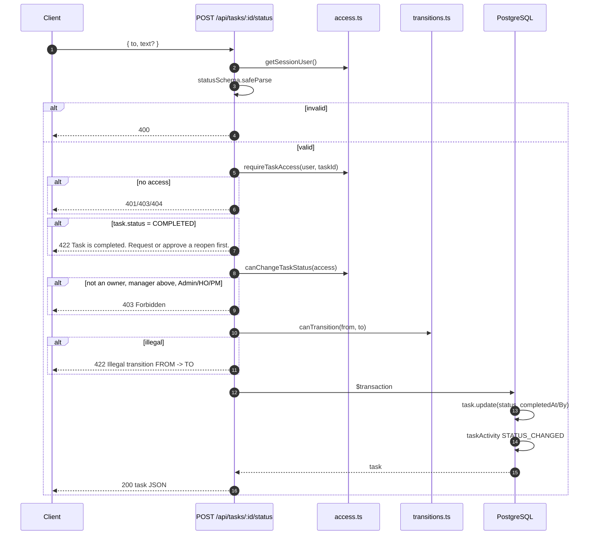

**Implementation notes**

* `app/api/tasks/[id]/status/route.ts`.
* `lib/access.ts#canChangeTaskStatus` — the task must not be completed, and the
  caller must be an assignee, the creator, a manager-chain ancestor, or hold
  Admin, Head Office or Project Manager on the task. A site-manager peer who can
  see the task is refused here.
* `lib/transitions.ts` — `TODO → IN_PROGRESS|BLOCKED|COMPLETED`,
  `IN_PROGRESS → BLOCKED|COMPLETED|TODO`, `BLOCKED → IN_PROGRESS|TODO|COMPLETED`,
  `COMPLETED → []`. A no-op transition (`from === to`) is allowed.
* Completing sets `completedAt = now()` and `completedById = user.id`; any other
  transition clears both.
* The optional `text` becomes the activity note.
* The activity row records `fromStatus` and `toStatus`.

---

## 8. Reopen request, approval and cancellation

Completed tasks are locked. Project and site managers request a reopen; Admin
and Head Office can reopen directly or decide on a request.

### 8.1 Request or direct reopen

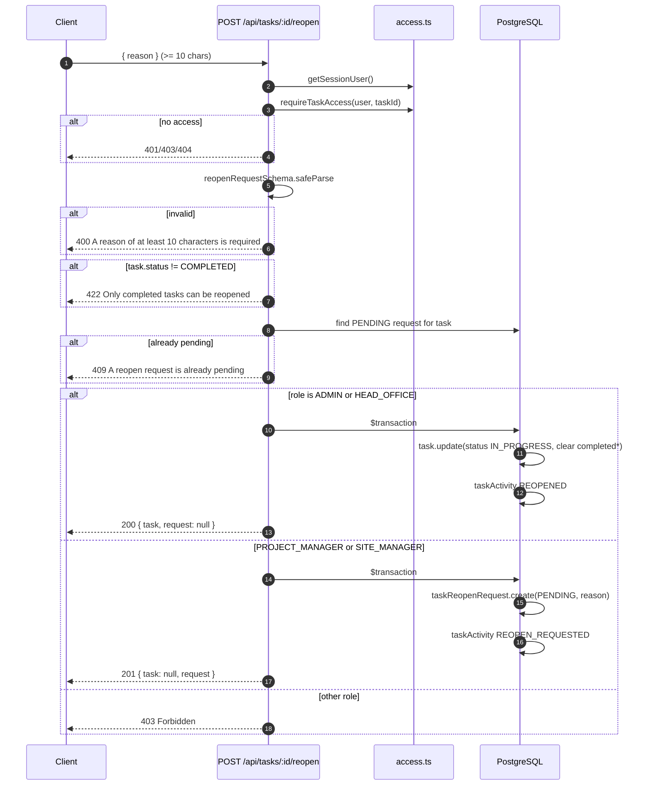

**Implementation notes**

* `app/api/tasks/[id]/reopen/route.ts#POST` — branch chosen by whether the body
  contains a `decision` key.
* `canReopenDirectly(role)` — Admin or Head Office.
* `canRequestReopen(task, role)` — completed task and role is Project Manager or
  Site Manager.
* The partial unique index `TaskReopenRequest_taskId_pending_key` guarantees at
  most one pending request per task; the route also checks explicitly to return
  a clean `409`.

### 8.2 Approve or reject

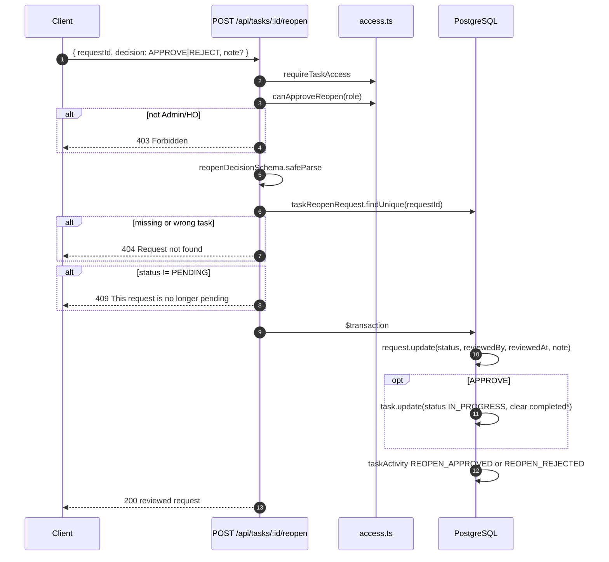

**Implementation notes**

* Approval moves the task to `IN_PROGRESS` and clears `completedAt` /
  `completedById`. Rejection leaves the task `COMPLETED`.
* The activity text is `reason` or `reason — note`.

### 8.3 Cancel a pending request

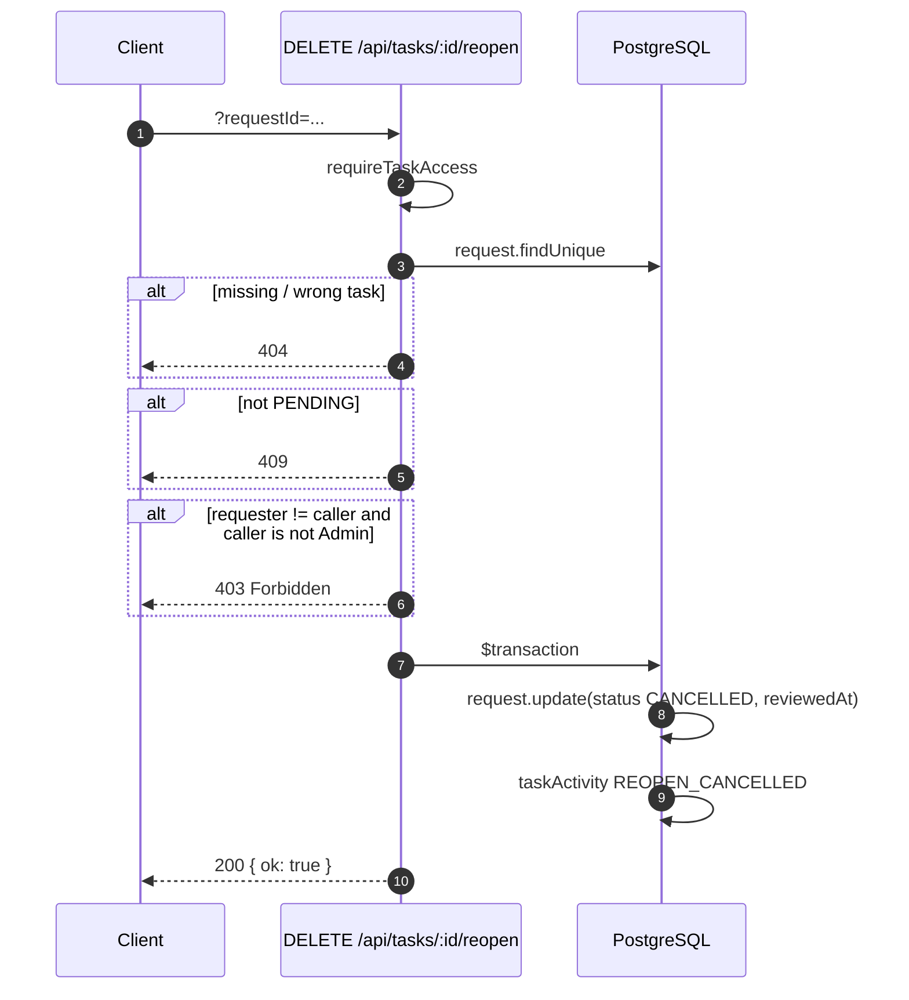

---

## 9. Attachment upload and download

**When:** a user attaches a photo or PDF to a task or a comment.

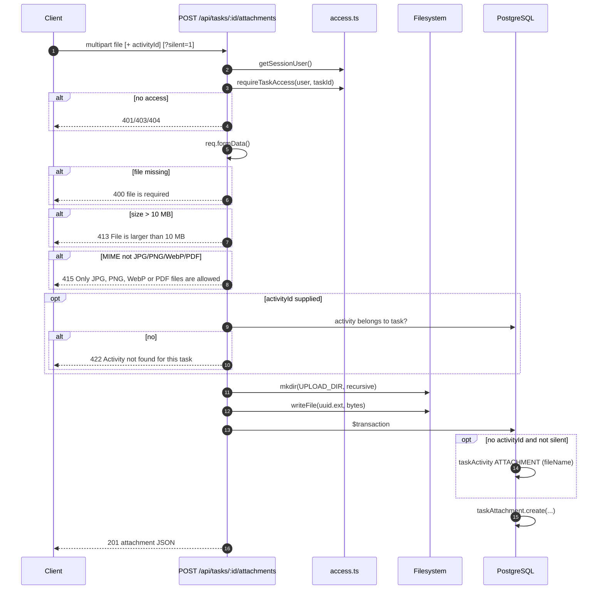

**Implementation notes**

* `app/api/tasks/[id]/attachments/route.ts` — `runtime = "nodejs"`; extension
  derived from MIME; stored name is a UUID, original name kept in `fileName`.
* `?silent=1` suppresses the feed activity, used when the file will be attached
  to a comment in a second call.
* Comment flow: upload with `silent=1`, then
  `POST /api/tasks/:id/comments { text, attachmentIds }` links the unlinked
  attachment to the new `COMMENT` activity.
* Download: `GET /api/attachments/:id` looks up the row, calls
  `requireTaskAccess(user, attachment.taskId)`, reads the file and streams it
  with the stored MIME type and `Content-Disposition: inline`.
* Delete: uploader or Admin; the row is deleted first, then the file is
  unlinked (failures ignored).

---

## 10. Master-data update and audit

**When:** an Admin or Head Office member edits a company, project, plaza, user,
category, membership or assignment.

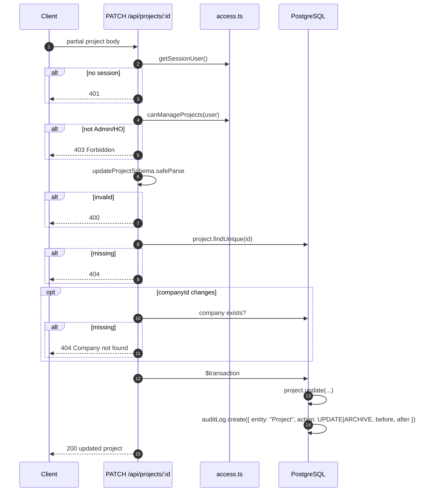

**Implementation notes**

* `lib/audit.ts#logAudit` takes the transaction client, so the audit row commits
  or rolls back with the change.
* `snapshot(record, keys)` whitelists fields; `User` snapshots never include
  `passwordHash` (a password change is recorded as `passwordChanged: true`).
* `action` is `ARCHIVE` when `active === false`, otherwise `UPDATE`.
* The same pattern is used by companies, plazas, users, categories,
  head-office memberships and project assignments. See the endpoint table in
  [`API.md`](./API.md).
* `GET /api/audit` reads the result, newest first, filterable by `entity`,
  `entityId`, `actorId`.

---

## 11. Plaza access update and audit

**When:** an Admin/Head Office member replaces a user's plaza roles on the
Access screen.

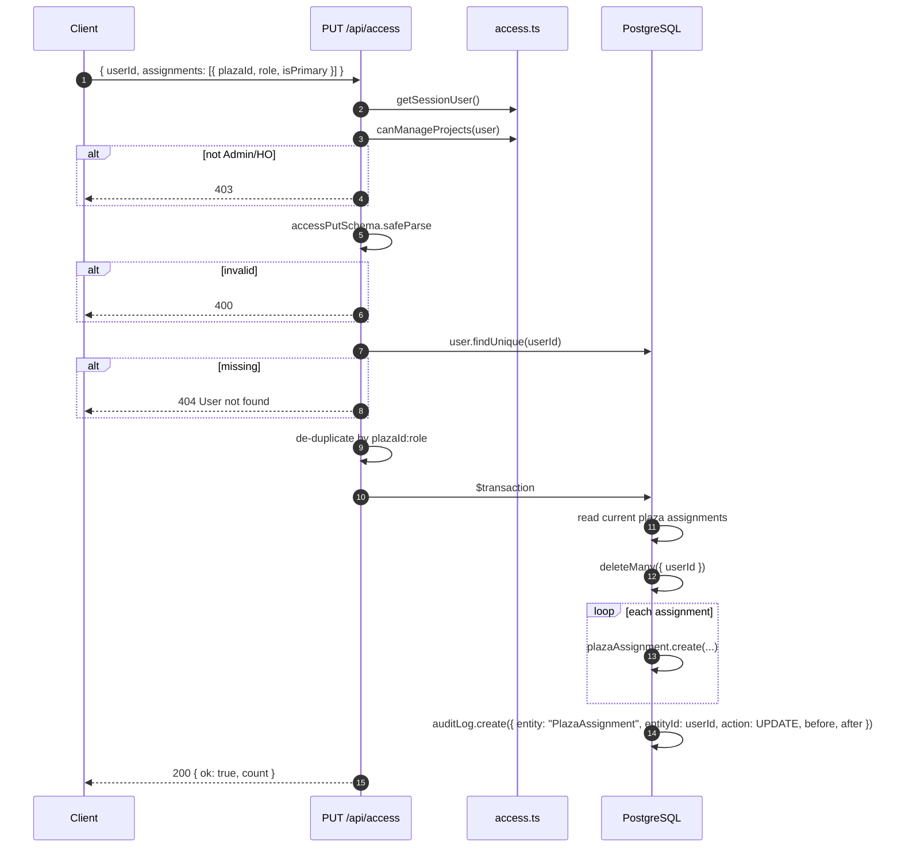

**Implementation notes**

* `app/api/access/route.ts#PUT` — replace-all semantics, not a diff. The
  `before` and `after` arrays are sorted by `plazaId`, then `role`.
* `assignedById` is set to the caller on every created row.
* `accessPutSchema` caps the payload at 500 assignments.
* Project-manager assignments are managed separately by
  `POST/DELETE /api/project-assignments`; Head Office departments by
  `POST/PUT/DELETE /api/head-office-memberships`.

---

## 12. Comment with an attachment

**When:** a user posts a comment, optionally with photos already uploaded.

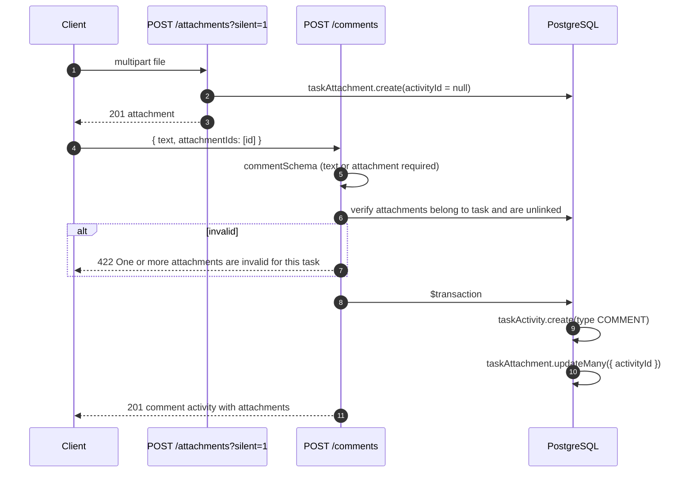

**Implementation notes**

* `commentSchema` requires either non-empty text or at least one attachment.
* Comments are allowed on completed tasks; they do not change status or
  `updatedAt` semantics beyond the activity row.
* There is no edit or delete endpoint for comments.
